# Arduino Starter Kit — Component Reference

This catalog follows the 42 entries in the supplied **Arduino Starter Kit – Component Guide**. The three description fields are retained from that guide. Each component image is loaded from the matching local file in `images/`; the actual kit may use a visually similar clone or supplier variant.

> **Image and licensing note:** Most image links below are product/vendor images. The source pages do not establish a reusable license in the search results, so verify permission before redistribution or commercial use. The Arduino UNO R3 image is from Wikimedia Commons under CC BY-SA 4.0 and requires attribution/share-alike.

## 01. Controller Board

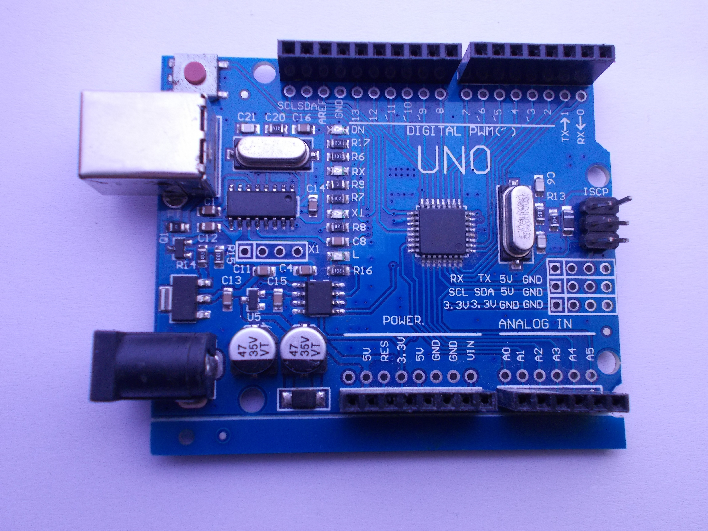

**Image source:** [https://commons.wikimedia.org/wiki/File:Arduino_Uno_R3_development_board_03.jpg](https://commons.wikimedia.org/wiki/File:Arduino_Uno_R3_development_board_03.jpg)

**What is it?**
The controller board is the main control unit of the project. It runs the program uploaded by the user and sends signals to connected components.

**How does it work?**
The microcontroller reads inputs from sensors or buttons, processes the program instructions, and controls outputs such as LEDs, motors, and displays.

**Example in a project**
Use it as the brain of an automatic plant-watering system: read the moisture sensor and control a pump or indicator.

<small>Image match: Arduino UNO R3 form factor; the photographed board is a blue clone/variant, not necessarily the exact kit board. License: CC BY-SA 4.0 — author Shoot stufz; attribution and ShareAlike required</small>

---

## 02. USB Cable

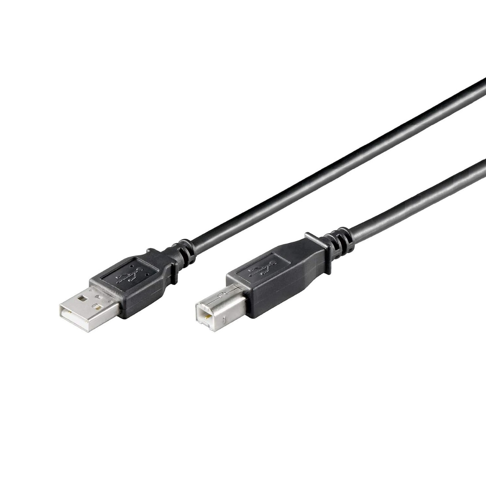

**Image source:** [https://www.ewent-eminent.com/en/products/114-cables/usb-20-a%7Cm-to-b%7Cm-cable-18-m-0](https://www.ewent-eminent.com/en/products/114-cables/usb-20-a%7Cm-to-b%7Cm-cable-18-m-0)

**What is it?**
The USB cable connects the controller board to a computer or a compatible USB power source.

**How does it work?**
It can provide power and, on supported boards, transfer the program and serial data between the computer and the board.

**Example in a project**
Connect the board to the computer when uploading an Arduino sketch or checking serial output.

<small>Image match: USB Type-A to Type-B cable, the common UNO R3 cable form. License: Not verified; check source page before redistribution</small>

---

## 03. 830 Tie-Points Breadboard

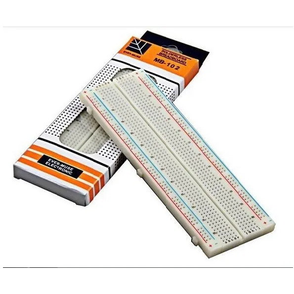

**Image source:** [https://www.digikey.com/en/products/detail/busboard-prototype-systems/BB830/19200392](https://www.digikey.com/en/products/detail/busboard-prototype-systems/BB830/19200392)

**What is it?**
A breadboard is a reusable board for building temporary circuits without soldering.

**How does it work?**
Its internal metal strips connect certain holes together. Components and jumper wires are inserted into the holes to form a circuit.

**Example in a project**
Build and test an LED circuit with a resistor before making permanent connections.

<small>Image match: BB830 / 830-point solderless breadboard; close match to the named item. License: Not verified; check source page before redistribution</small>

---

## 04. Remote

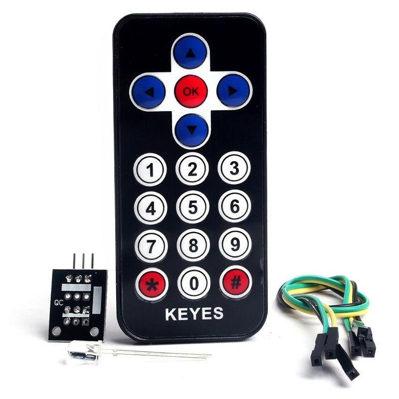

**Image source:** [https://electra.store/products/infrared-remote-control](https://electra.store/products/infrared-remote-control)

**What is it?**
The remote is a handheld infrared controller with buttons for sending commands.

**How does it work?**
When a button is pressed, it sends a coded infrared signal. An IR receiver module detects the signal so the controller board can interpret it.

**Example in a project**
Use the remote to select modes or switch an LED on and off from a distance.

<small>Image match: 17-key infrared remote kit; visual form matches typical Arduino IR remotes. License: Not verified; check source page before redistribution</small>

---

## 05. 65 Jumper Wire

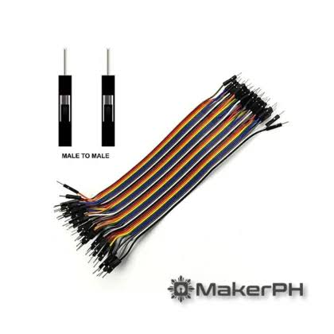

**Image source:** [https://electronikz.com/products/breadboard-jumper-wires-set](https://electronikz.com/products/breadboard-jumper-wires-set)

**What is it?**
Jumper wires are insulated wires used to connect components and board pins.

**How does it work?**
They carry electrical power or signals between the controller, breadboard, sensors, and modules. The wire ends must match the connection type.

**Example in a project**
Connect a sensor's VCC, GND, and signal pins to the appropriate board or breadboard points.

<small>Image match: 65-piece colorful male-to-male jumper wire bundle. License: Not verified; check source page before redistribution</small>

---

## 06. Stepper Motor

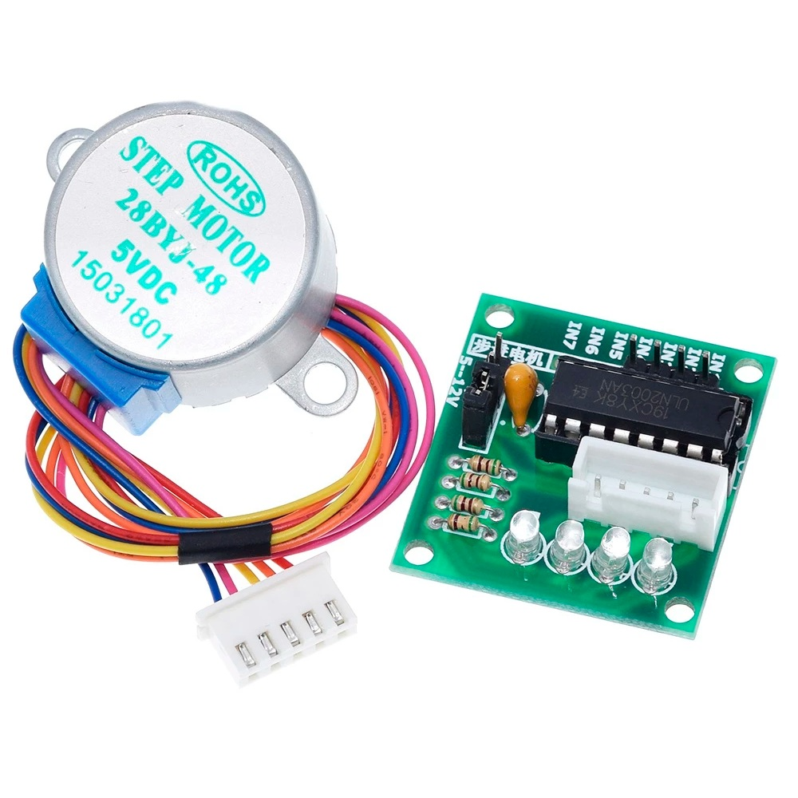

**Image source:** [https://shopee.com.br/Motor-de-Passo-28BYJ-48-com-Driver-ULN2003-Para-Arduino-i.992479881.22495647626](https://shopee.com.br/Motor-de-Passo-28BYJ-48-com-Driver-ULN2003-Para-Arduino-i.992479881.22495647626)

**What is it?**
A stepper motor rotates in small, controlled steps rather than spinning freely like a basic DC motor.

**How does it work?**
Its coils are energized in a sequence. Changing the sequence and number of steps controls direction and position.

**Example in a project**
Use it for a small rotating platform or a model gate that needs controlled movement.

<small>Image match: 28BYJ-48 5V stepper motor. The matching ULN2003 board is component 9. License: Not verified; marketplace product image; check seller rights</small>

---

## 07. Servo Motor (SG90)

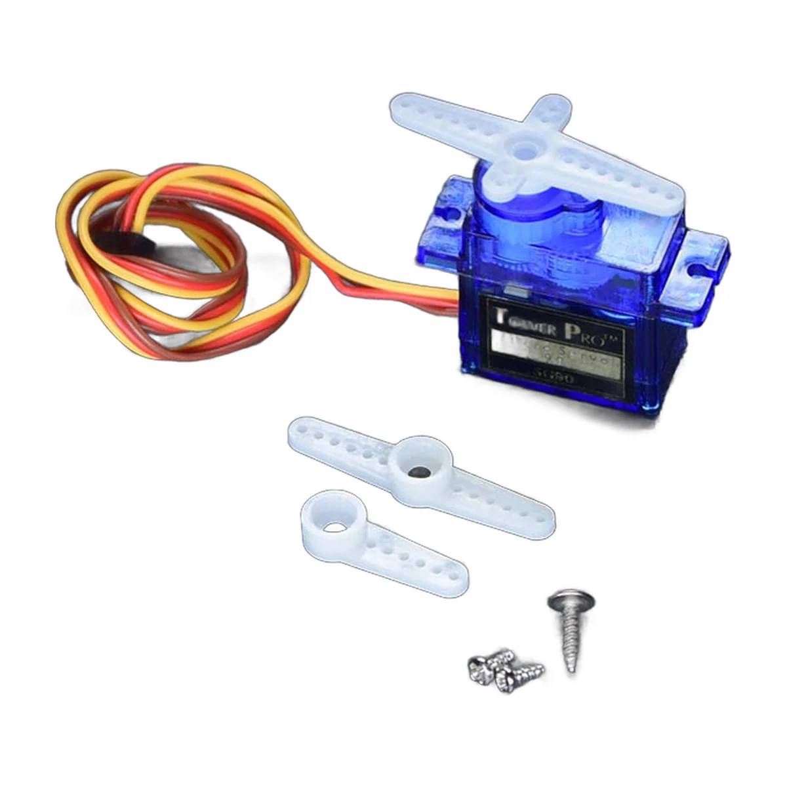

**Image source:** [https://www.hellasdigital.gr/go-create/servo/servos/towerpro-micro-servo-motor-sg90-9g-rc-robot-helicopter-airplane/](https://www.hellasdigital.gr/go-create/servo/servos/towerpro-micro-servo-motor-sg90-9g-rc-robot-helicopter-airplane/)

**What is it?**
A servo motor is designed to move its output shaft to a commanded angle within its operating range.

**How does it work?**
A control signal tells the servo what position to move to. The motor's internal control circuit adjusts the shaft to reach that position.

**Example in a project**
Move a small barrier arm to an open or closed position in an automatic gate model.

<small>Image match: TowerPro SG90 9g blue micro servo, same model named in the guide. License: Not verified; check source page before redistribution</small>

---

## 08. 1602 I2C LCD

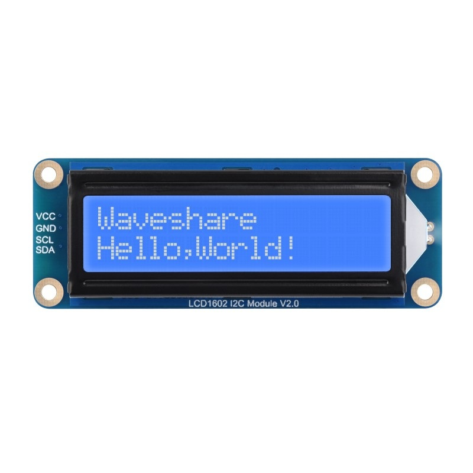

**Image source:** [https://www.waveshare.com/lcd1602-i2c-module-blue.htm](https://www.waveshare.com/lcd1602-i2c-module-blue.htm)

**What is it?**
The 1602 I2C LCD is a character display that can show up to 16 characters on each of two lines.

**How does it work?**
The I2C interface lets the controller communicate using the shared data and clock lines, along with power and ground.

**Example in a project**
Display sensor readings, a welcome message, or the current system status.

<small>Image match: Blue 16x2 character LCD with four-pin I2C interface. License: Not verified; check source page before redistribution</small>

---

## 09. ULN2003 Stepper Motor Driver Board

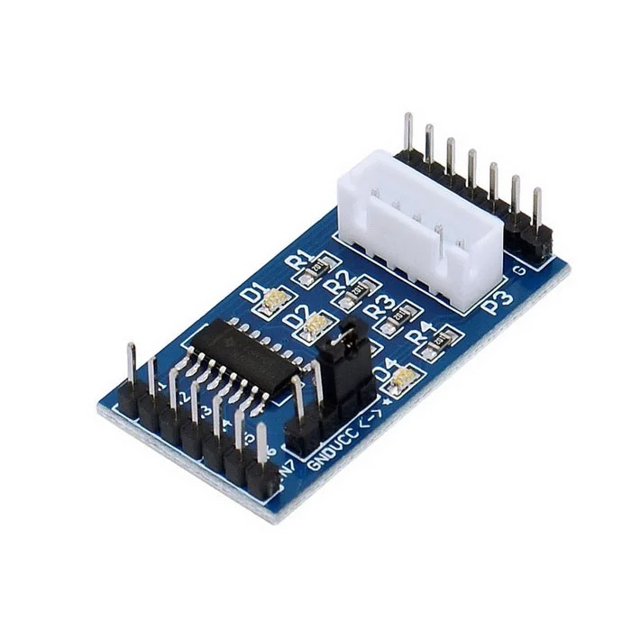

**Image source:** [https://potentiallabs.com/cart/buy-uln2003-stepper-motor-driver-module-online](https://potentiallabs.com/cart/buy-uln2003-stepper-motor-driver-module-online)

**What is it?**
The ULN2003 board is a driver module commonly used to control a small unipolar stepper motor.

**How does it work?**
It receives control signals from the controller and switches current through the motor coils. It helps the controller drive the motor without powering the coils directly from its I/O pins.

**Example in a project**
Use it with a compatible stepper motor in a small positioning or rotating-display project.

<small>Image match: ULN2003 driver PCB for the 28BYJ-48 family of small unipolar steppers. License: Not verified; check source page before redistribution</small>

---

## 10. Power Supply Module

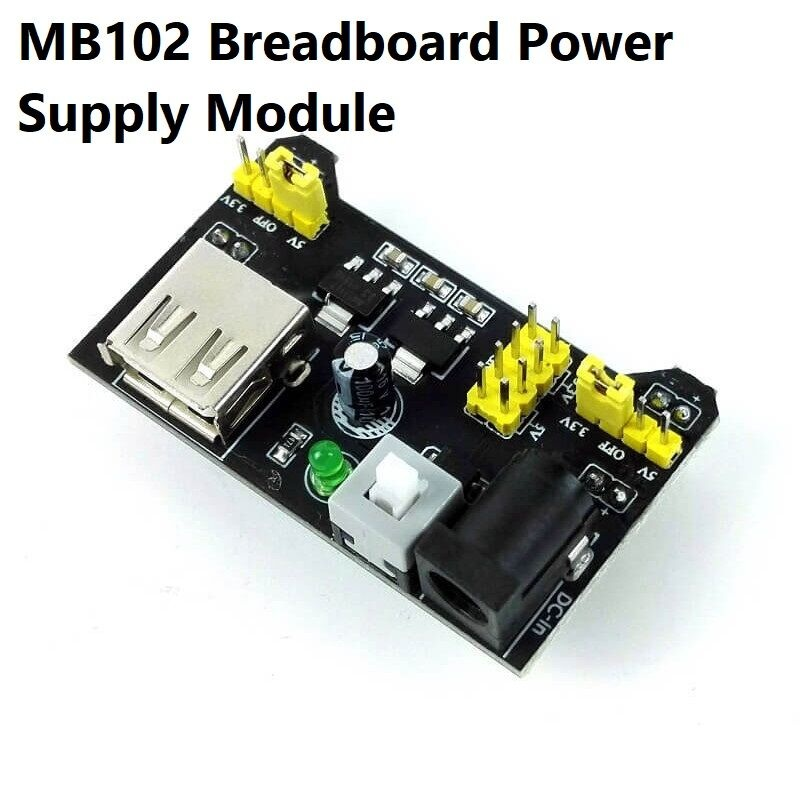

**Image source:** [https://www.daraz.com.bd/products/mb102-breadboard-power-supply-module-solderless-33v-5v-breadboard-power-supply-module-for-arduino-diy-do-not-need-any-cables-for-power-supply-i324690605.html](https://www.daraz.com.bd/products/mb102-breadboard-power-supply-module-solderless-33v-5v-breadboard-power-supply-module-for-arduino-diy-do-not-need-any-cables-for-power-supply-i324690605.html)

**What is it?**
The power supply module provides regulated power rails for a breadboard circuit.

**How does it work?**
It accepts a suitable input supply and provides selectable output voltage rails on supported breadboard power pins. Check the module's input and output ratings before use.

**Example in a project**
Power a low-voltage sensor circuit on a breadboard while keeping the controller and module grounds connected.

<small>Image match: MB102-style breadboard power supply module. License: Not verified; marketplace product image; check seller rights</small>

---

## 11. Joystick Module

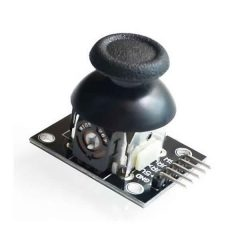

**Image source:** [https://naylampmechatronics.com/interfaz-de-usuario/36-modulo-joystick-dual-axis-ky-023.html](https://naylampmechatronics.com/interfaz-de-usuario/36-modulo-joystick-dual-axis-ky-023.html)

**What is it?**
A joystick module provides two-axis movement input and often includes a push-button switch.

**How does it work?**
Moving the stick changes the X and Y analog output voltages. Pressing the stick activates its switch output.

**Example in a project**
Control the direction of a servo or move a cursor in a simple menu.

<small>Image match: KY-023 dual-axis joystick board with integrated push switch. License: Not verified; check source page before redistribution</small>

---

## 12. Membrane Switch Module

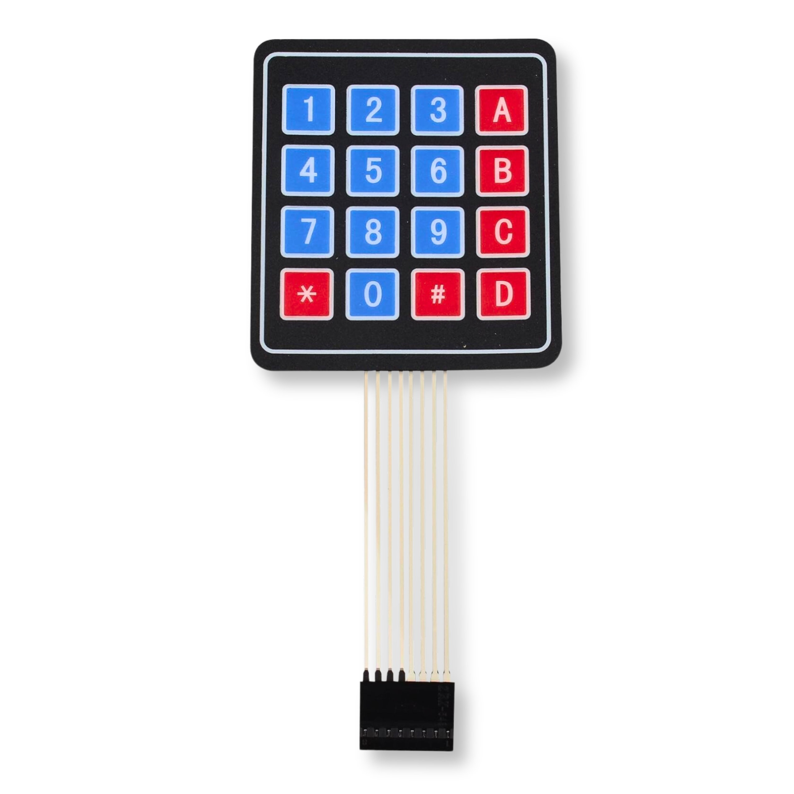

**Image source:** [https://mikrobot.pl/Klawiatura-membranowa-4x4-samoprzylepna-16-przyciskow-8-pin-35V-do-Arduino](https://mikrobot.pl/Klawiatura-membranowa-4x4-samoprzylepna-16-przyciskow-8-pin-35V-do-Arduino)

**What is it?**
A membrane switch module is a flat keypad made of several pressable buttons.

**How does it work?**
Pressing a key closes a contact in the keypad matrix. The controller scans the row and column connections to identify the pressed key.

**Example in a project**
Enter a PIN code for a simple electronic door-lock demonstration.

<small>Image match: 16-key 4x4 membrane keypad, a common kit form. License: Not verified; check source page before redistribution</small>

---

## 13. Water Level Detection Sensor Module

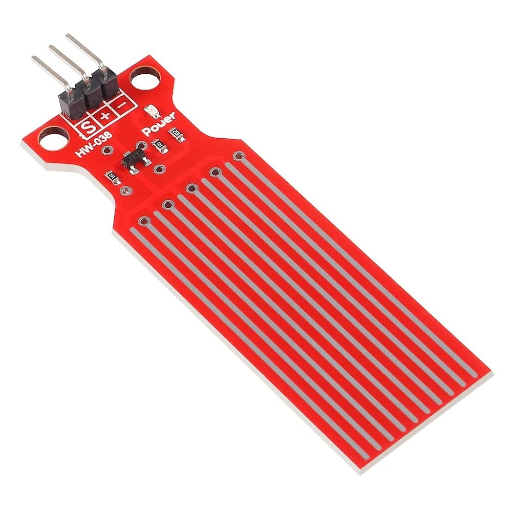

**Image source:** [https://iduino.co.in/product/water-level-sensor-module/](https://iduino.co.in/product/water-level-sensor-module/)

**What is it?**
This sensor module detects the presence or level of water at its exposed sensing tracks.

**How does it work?**
Water contacting the conductive tracks changes the electrical response of the sensor. The controller reads the module output to detect water.

**Example in a project**
Create a water-tank alert that lights an LED or sounds a buzzer when water reaches a set level.

<small>Image match: Resistive water-level probe with exposed parallel sensing traces. License: Not verified; check source page before redistribution</small>

---

## 14. Sound Sensor Module

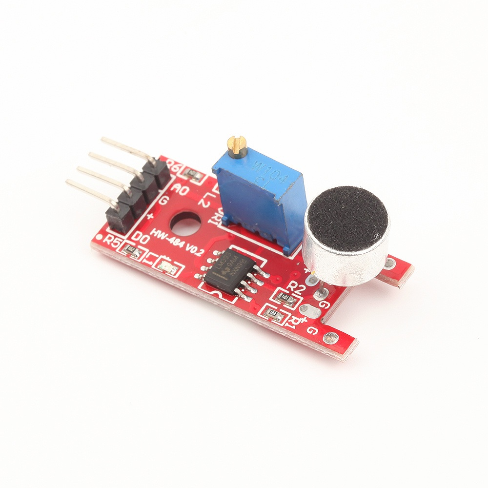

**Image source:** [https://www.ebay.com/itm/385494561952](https://www.ebay.com/itm/385494561952)

**What is it?**
A sound sensor module detects sound intensity using a microphone and signal-conditioning circuit.

**How does it work?**
Sound creates tiny electrical changes at the microphone. The module conditions the signal and provides an output that the controller can read.

**Example in a project**
Make an LED respond when the sensor detects a clap or a loud sound.

<small>Image match: KY-038-style microphone sound sensor module; board color/layout can vary. License: Not verified; marketplace product image; check seller rights</small>

---

## 15. Fan Blade

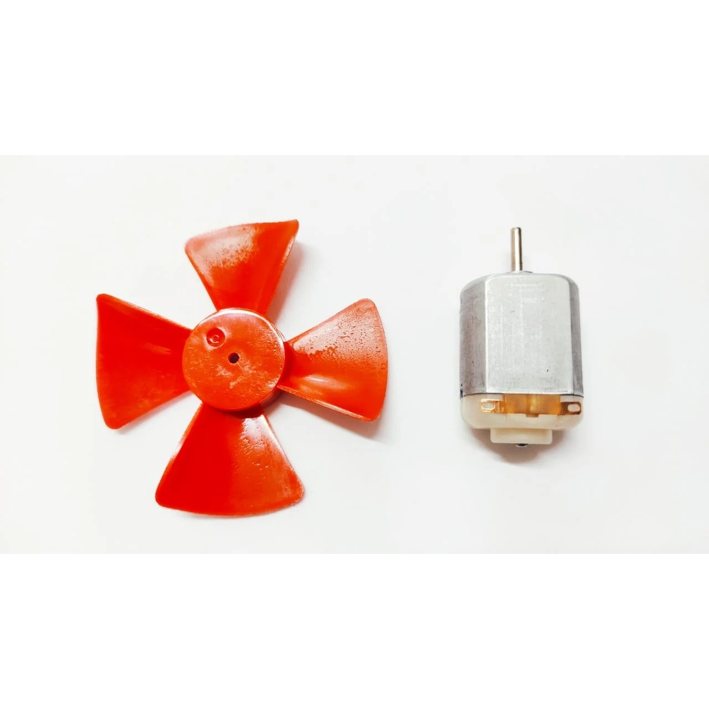

**Image source:** [https://www.arcaelectronica.com/products/motor-dc-3v-6v-helice-proyecto-arduino-juguete](https://www.arcaelectronica.com/products/motor-dc-3v-6v-helice-proyecto-arduino-juguete)

**What is it?**
A fan blade moves air when it rotates.

**How does it work?**
The blade attaches to a compatible motor shaft. As the motor spins, the angled blades push air and create airflow.

**Example in a project**
Attach it to a suitable motor for a small fan demonstration. Keep fingers clear while it is powered.

<small>Image match: Small red plastic four-blade propeller used with a small DC motor; similar kit accessory. License: Not verified; check source page before redistribution</small>

---

## 16. 1 Digit 7-Segment Display

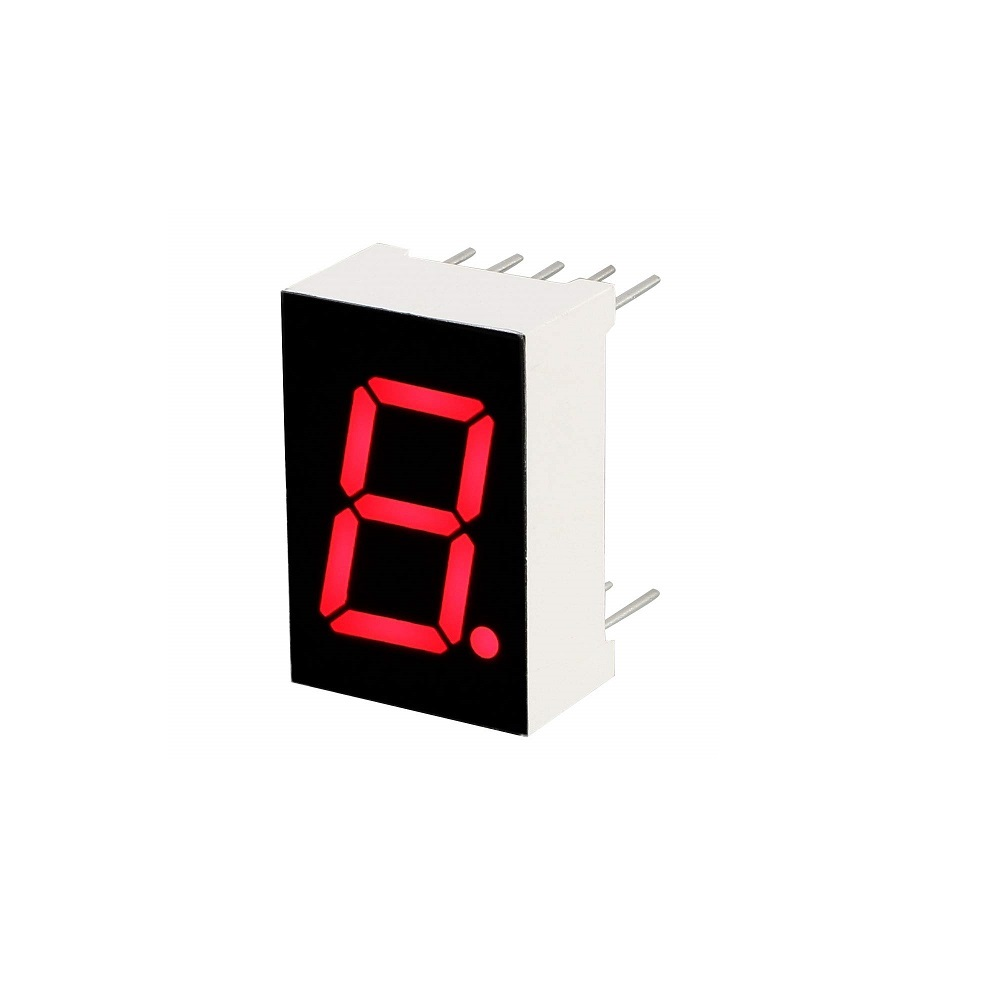

**Image source:** [https://robu.in/product/0-56-inch-red-1-digit-7-segment-led-display-10pin/](https://robu.in/product/0-56-inch-red-1-digit-7-segment-led-display-10pin/)

**What is it?**
A one-digit 7-segment display shows numbers using seven individual LED segments.

**How does it work?**
The controller turns selected segments on or off to form a digit. The display may be common-anode or common-cathode, so wiring and code must match its type.

**Example in a project**
Display a single counter value, such as 0 through 9.

<small>Image match: Red one-digit 7-segment component with decimal point. License: Not verified; check source page before redistribution</small>

---

## 17. 4 Digit 7-Segment Display

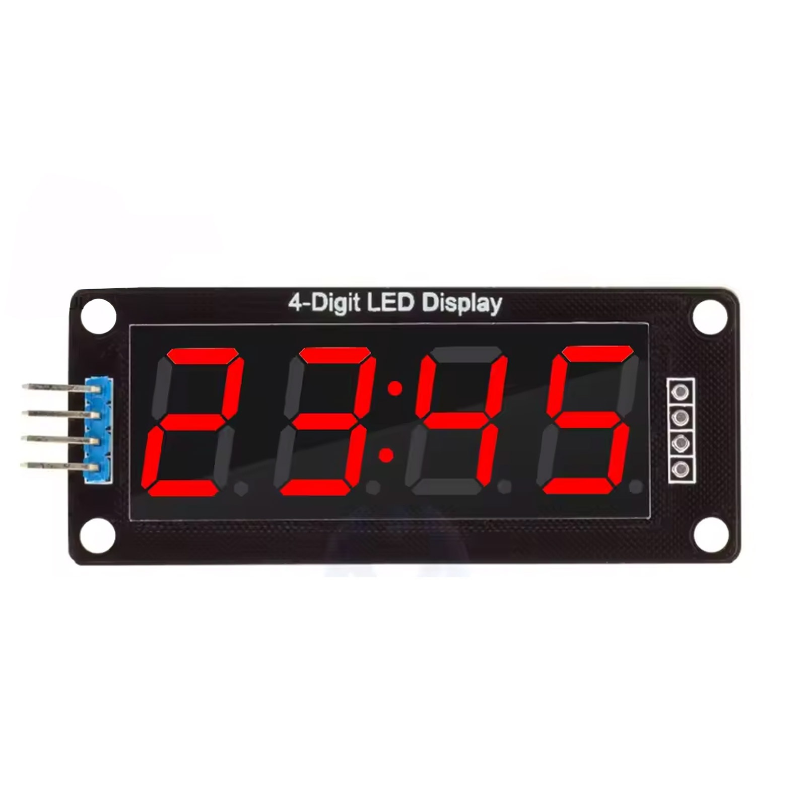

**Image source:** [https://www.roboter-bausatz.de/p/7-segment-display-modul-4-stellig-rot-tm1637-0.56](https://www.roboter-bausatz.de/p/7-segment-display-modul-4-stellig-rot-tm1637-0.56)

**What is it?**
A four-digit 7-segment display shows four numeric digits in one module.

**How does it work?**
The controller rapidly selects each digit and its segments. This multiplexing makes all four digits appear lit at the same time.

**Example in a project**
Show a timer, score, or four-digit sensor reading.

<small>Image match: Four-digit red 7-segment module; this example has a TM1637 driver. License: Not verified; check source page before redistribution</small>

---

## 18. Ultrasonic Sensor

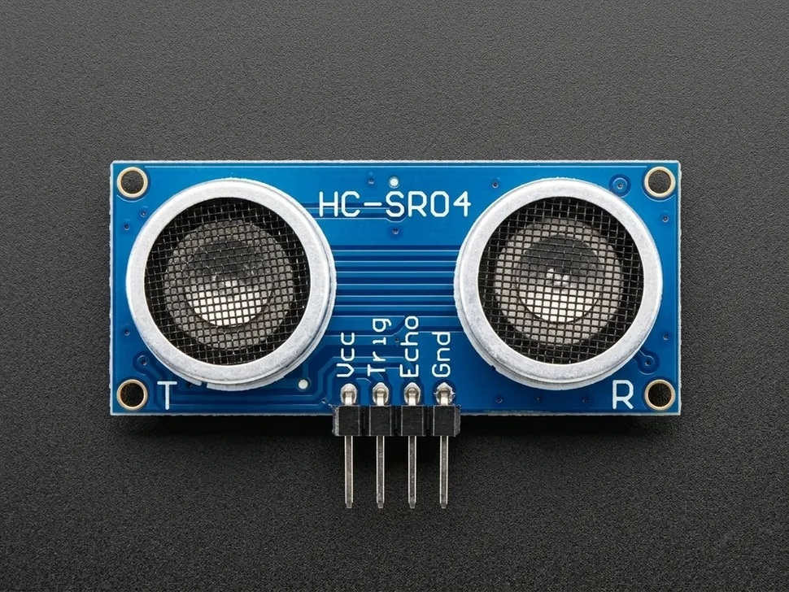

**Image source:** [https://www.thingbits.in/products/hc-sr04-ultrasonic-distance-sensor](https://www.thingbits.in/products/hc-sr04-ultrasonic-distance-sensor)

**What is it?**
An ultrasonic sensor measures distance using high-frequency sound waves.

**How does it work?**
It sends an ultrasonic pulse and measures how long the echo takes to return. The controller uses the travel time to estimate distance.

**Example in a project**
Build a parking-distance indicator or an obstacle-detection model.

<small>Image match: HC-SR04 board with twin ultrasonic transducers. License: Not verified; check source page before redistribution</small>

---

## 19. DHT11 Temperature and Humidity Module

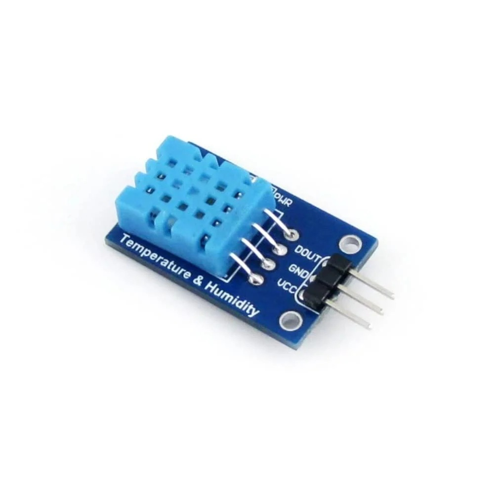

**Image source:** [https://electro-robo.com/products/dht11-humidity-and-temperature-sensor-module](https://electro-robo.com/products/dht11-humidity-and-temperature-sensor-module)

**What is it?**
The DHT11 measures surrounding temperature and relative humidity.

**How does it work?**
It sends digital data to the controller through its data connection. Readings are less precise and have a narrower range than some higher-end sensors.

**Example in a project**
Display room temperature and humidity on an LCD.

<small>Image match: DHT11 blue sensor mounted on a small interface PCB. License: Not verified; check source page before redistribution</small>

---

## 20. 10K Potentiometer

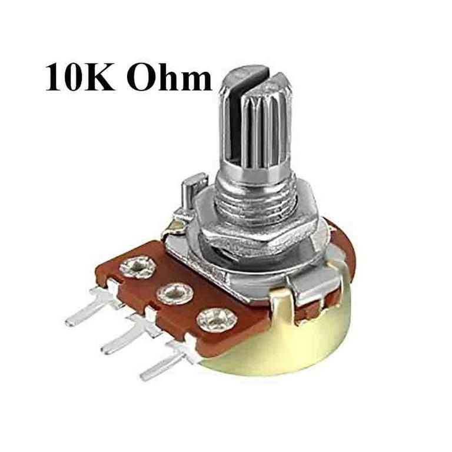

**Image source:** [https://www.olx.com.pk/item/1-pcs-10k-ohm-variable-resistors-rotary-potentiometer-3-pin-mono-volume-control-iid-ev446426-1](https://www.olx.com.pk/item/1-pcs-10k-ohm-variable-resistors-rotary-potentiometer-3-pin-mono-volume-control-iid-ev446426-1)

**What is it?**
A 10K potentiometer is an adjustable resistor with three terminals.

**How does it work?**
Turning its shaft changes the resistance between the wiper and the two outer terminals. It can be wired as a voltage divider to provide an adjustable analog voltage.

**Example in a project**
Use it to adjust LED brightness or set a threshold value.

<small>Image match: Three-terminal rotary 10K potentiometer with metal shaft. License: Not verified; check source page before redistribution</small>

---

## 21. IR Receiver Module

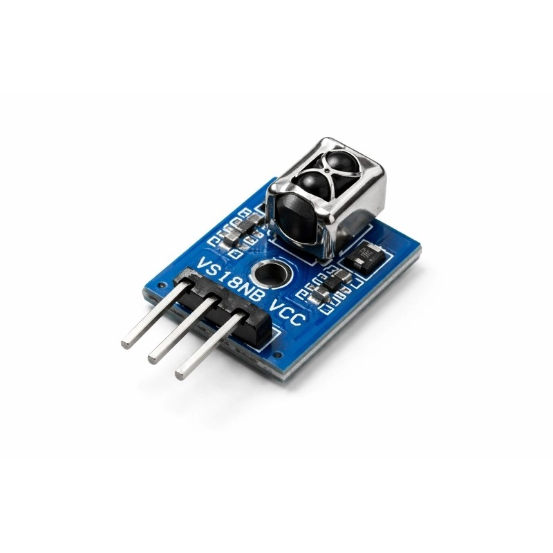

**Image source:** [https://dev.to/thilak_kumar/i-chose-the-vs1838b-ir-receiver-for-my-esp32-based-project-1o7l](https://dev.to/thilak_kumar/i-chose-the-vs1838b-ir-receiver-for-my-esp32-based-project-1o7l)

**What is it?**
An infrared receiver detects coded infrared light signals, such as those sent by a compatible remote.

**How does it work?**
It converts received infrared pulses into an electrical signal that the controller can decode.

**Example in a project**
Receive remote-control commands to change the mode of a project.

<small>Image match: VS1838B infrared receiver module; similar three-pin breakout. License: Not verified; check source page before redistribution</small>

---

## 22. 3–6V Motor (with wire)

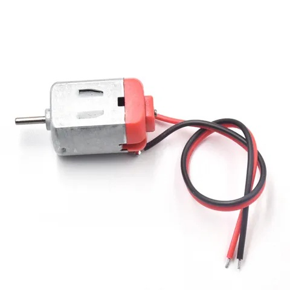

**Image source:** [https://www.jmaker.com.tw/products/product142-1](https://www.jmaker.com.tw/products/product142-1)

**What is it?**
A small 3–6V DC motor converts electrical energy into continuous rotational motion.

**How does it work?**
When suitable DC power is applied, current flows through the motor and creates motion. Use a driver transistor or motor-driver circuit when controlled by a microcontroller.

**Example in a project**
Spin a small wheel or fan in a low-voltage prototype.

<small>Image match: Small 130-size brushed DC motor with red and black leads. License: Not verified; check source page before redistribution</small>

---

## 23. 5V Relay

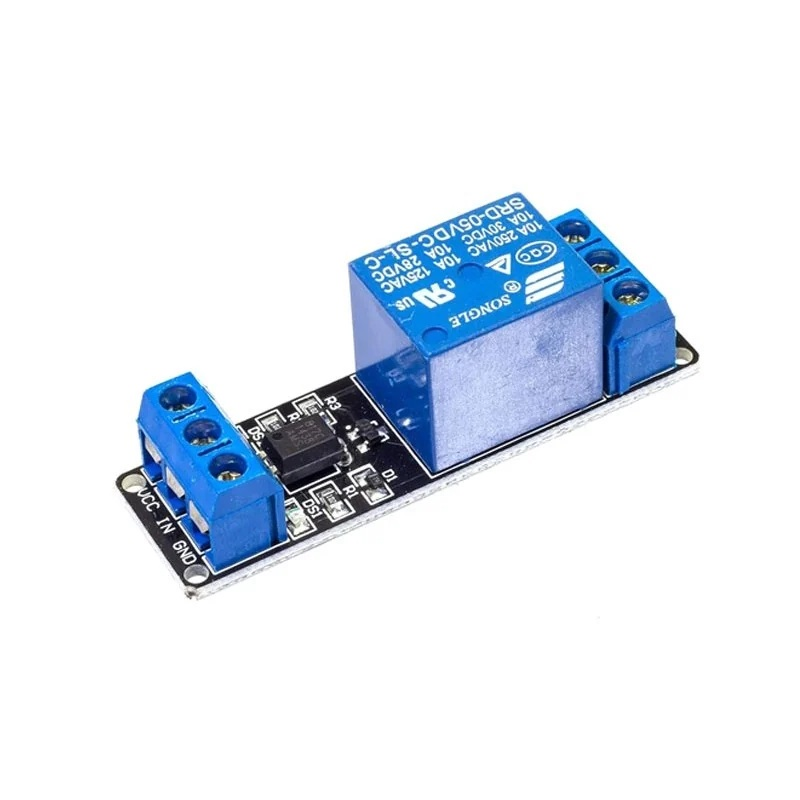

**Image source:** [https://www.pcfelectronics.nl/en/1-channel-relay-module-ideal-for-arduino.html](https://www.pcfelectronics.nl/en/1-channel-relay-module-ideal-for-arduino.html)

**What is it?**
A relay is an electrically controlled switch. This module uses a 5V control coil.

**How does it work?**
When the coil is energized, its contacts change state, allowing a low-voltage control signal to switch a separate circuit. Observe contact ratings and isolation requirements.

**Example in a project**
Switch a low-voltage lamp or other suitable load in a demonstration circuit.

<small>Image match: Single-channel 5V relay module; module PCB included in the image. License: Not verified; check source page before redistribution</small>

---

## 24. F-M Dupont Wire

**Image source:** [https://abc-rc.pl/en/products/dupont-m-f-jumper-cables-40-pcs-20cm-male-female-8761.html](https://abc-rc.pl/en/products/dupont-m-f-jumper-cables-40-pcs-20cm-male-female-8761.html)

**What is it?**
Female-to-male Dupont wires connect a female socket at one end to a male pin at the other.

**How does it work?**
They provide removable connections between modules, breadboards, and header pins without soldering.

**Example in a project**
Connect a module with male header pins to a breadboard or a board header.

<small>Image match: Colorful 40-wire female-to-male Dupont bundle; same connector configuration. License: Not verified; check source page before redistribution</small>

---

## 25. 9V Battery Connector With DC

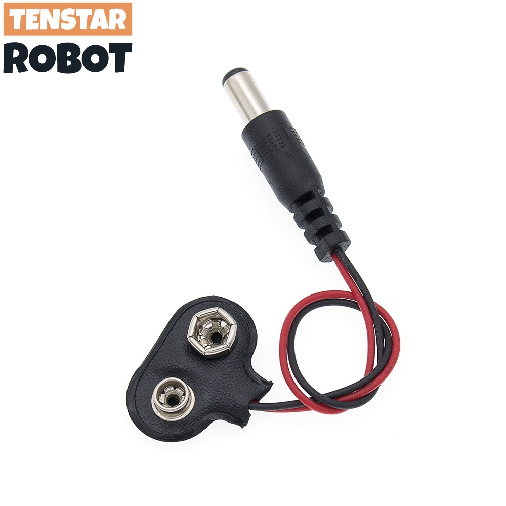

**Image source:** [https://shopee.com.my/9V-Battery-Holder-Connector-Snap-2.1mm-DC-Plug-Adapter-T-Type-for-Arduino-UNO-R3-Power-Supply-i.927139050.21072124487](https://shopee.com.my/9V-Battery-Holder-Connector-Snap-2.1mm-DC-Plug-Adapter-T-Type-for-Arduino-UNO-R3-Power-Supply-i.927139050.21072124487)

**What is it?**
This connector provides a way to connect a 9V battery to a compatible DC power input.

**How does it work?**
The battery's terminals connect through the snap connector and cable to the DC plug. Confirm polarity and the device's voltage requirements before connecting.

**Example in a project**
Power a compatible low-current prototype that is designed for a 9V input.

<small>Image match: 9V snap connector terminating in a DC barrel plug. License: Not verified; marketplace product image; check seller rights</small>

---

## 26. Tilt Switch

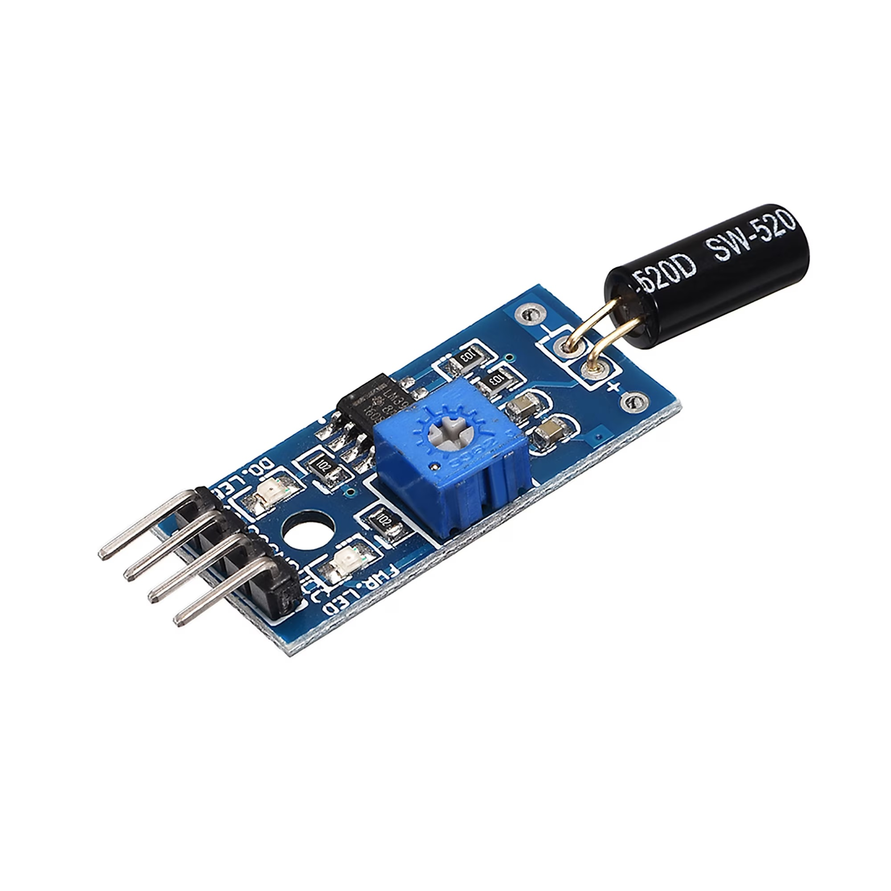

**Image source:** [https://www.walmart.com/ip/Angle-Sensor-Module-SW-520D-Ball-Switch-Tilt-Sensor-Module-for-Arduino-1pcs/924467457](https://www.walmart.com/ip/Angle-Sensor-Module-SW-520D-Ball-Switch-Tilt-Sensor-Module-for-Arduino-1pcs/924467457)

**What is it?**
A tilt switch detects a change in orientation or inclination.

**How does it work?**
A small internal conductive element changes contact state when the switch is tilted. The controller reads the resulting digital input.

**Example in a project**
Make a tilt alarm or detect when a model object has been moved.

<small>Image match: SW-520D ball-switch tilt sensor on an adjustable module PCB. License: Not verified; marketplace product image; check seller rights</small>

---

## 27. L293D

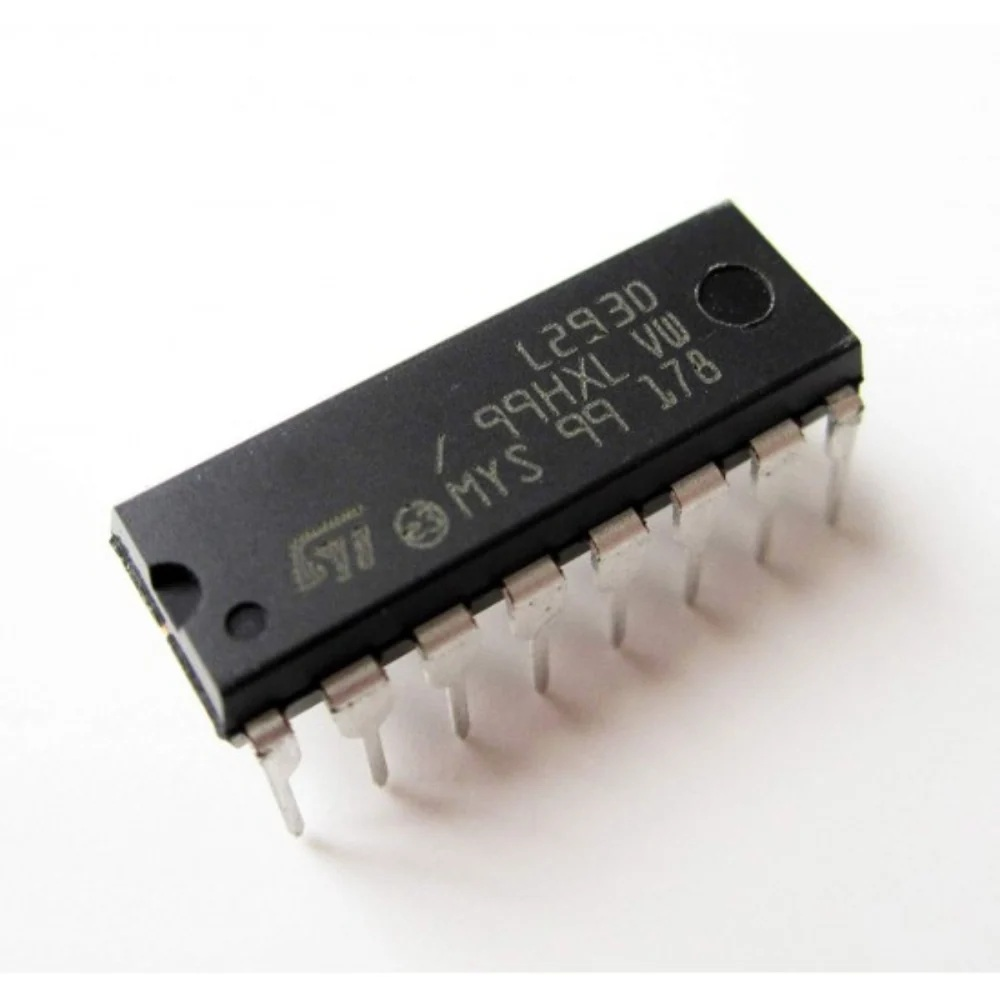

**Image source:** [https://robodo.in/products/l293d-dual-h-bridge-motor-driver-ic-dip-16-package](https://robodo.in/products/l293d-dual-h-bridge-motor-driver-ic-dip-16-package)

**What is it?**
The L293D is a dual H-bridge motor driver integrated circuit.

**How does it work?**
It allows a controller to control the direction of two DC motors, or one stepper motor, using separate logic and motor-supply connections within the chip's ratings.

**Example in a project**
Control forward and reverse movement of a small two-wheel robot.

<small>Image match: L293D dual H-bridge motor-driver IC in DIP-16 package. License: Not verified; check source page before redistribution</small>

---

## 28. 74HC595

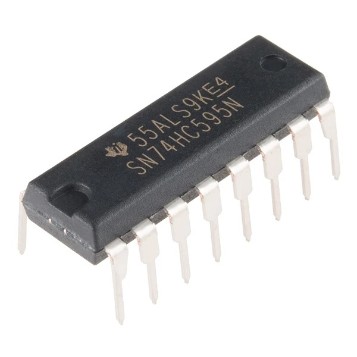

**Image source:** [https://www.sparkfun.com/shift-register-8-bit-sn74hc595.html](https://www.sparkfun.com/shift-register-8-bit-sn74hc595.html)

**What is it?**
The 74HC595 is an 8-bit serial-in, parallel-out shift register.

**How does it work?**
The controller sends data serially, then a latch signal updates eight output pins. It expands the number of digital outputs available.

**Example in a project**
Control multiple LEDs using only a few controller pins.

<small>Image match: SN74HC595N 8-bit shift-register IC in DIP-16 package. License: Not verified; check source page before redistribution</small>

---

## 29. Active Buzzer

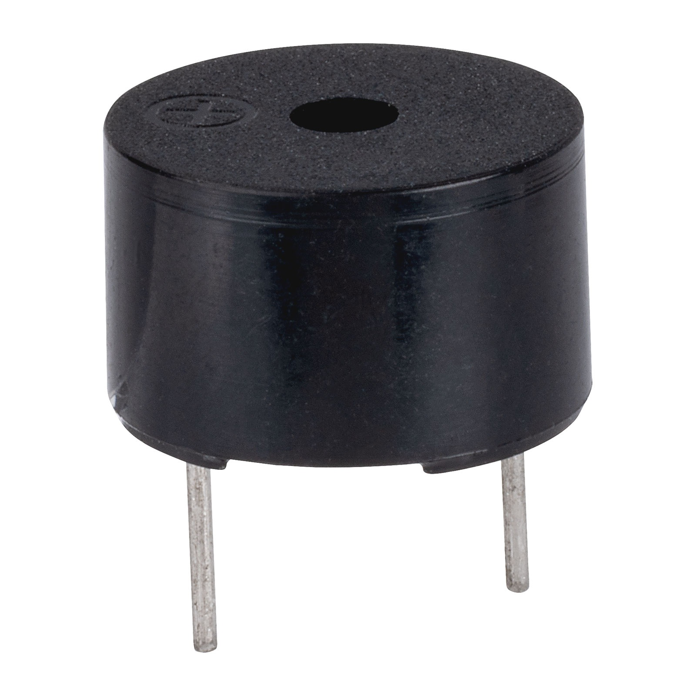

**Image source:** [https://www.rapidonline.com/rvfm-5v-miniature-electronic-buzzer-35-0048](https://www.rapidonline.com/rvfm-5v-miniature-electronic-buzzer-35-0048)

**What is it?**
An active buzzer produces a tone when supplied with the correct voltage.

**How does it work?**
It contains an internal oscillator, so it can make a sound from a simple on/off control signal.

**Example in a project**
Give an audible alert when a sensor detects a condition.

<small>Image match: 5V miniature active electronic buzzer with two leads. License: Not verified; check source page before redistribution</small>

---

## 30. Passive Buzzer

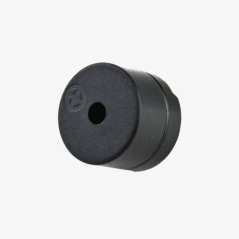

**Image source:** [https://quartzcomponents.com/products/small-piezoelectric-buzzer-5v-passive-buzzer](https://quartzcomponents.com/products/small-piezoelectric-buzzer-5v-passive-buzzer)

**What is it?**
A passive buzzer needs a changing signal to produce a tone.

**How does it work?**
The controller generates a frequency, often using a tone function, to make the buzzer vibrate and produce sound.

**Example in a project**
Play different beeps for different menu selections or warning levels.

<small>Image match: Small black passive piezo buzzer; visually similar to common kit buzzer. License: Not verified; check source page before redistribution</small>

---

## 31. Button (Small)

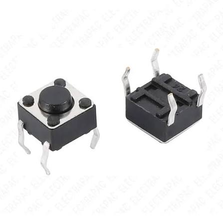

**Image source:** [https://www.shenzhen2u.com/Mini-Push-Button-Switch](https://www.shenzhen2u.com/Mini-Push-Button-Switch)

**What is it?**
A small push-button is a momentary switch that is active only while pressed.

**How does it work?**
Pressing it connects its contacts; releasing it opens them. A pull-up or pull-down arrangement is used to keep the input stable.

**Example in a project**
Use it to start a timer, reset a counter, or select a menu option.

<small>Image match: 6x6mm momentary tactile push-button switch. License: Not verified; check source page before redistribution</small>

---

## 32. Photoresistor (Photocell)

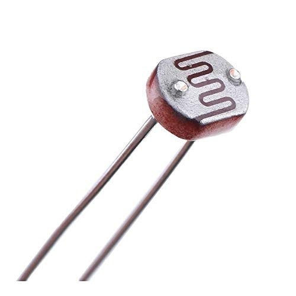

**Image source:** [https://bigyanproject.com/en/ldr/5mm-ldr-sensor](https://bigyanproject.com/en/ldr/5mm-ldr-sensor)

**What is it?**
A photoresistor changes its resistance depending on the amount of light falling on it.

**How does it work?**
Its resistance usually decreases as light intensity increases. A voltage-divider circuit lets the controller read the change as an analog value.

**Example in a project**
Automatically turn on an LED when the surroundings become dark.

<small>Image match: 5mm GL5516-style photoresistor with serpentine sensing track. License: Not verified; check source page before redistribution</small>

---

## 33. Thermistor

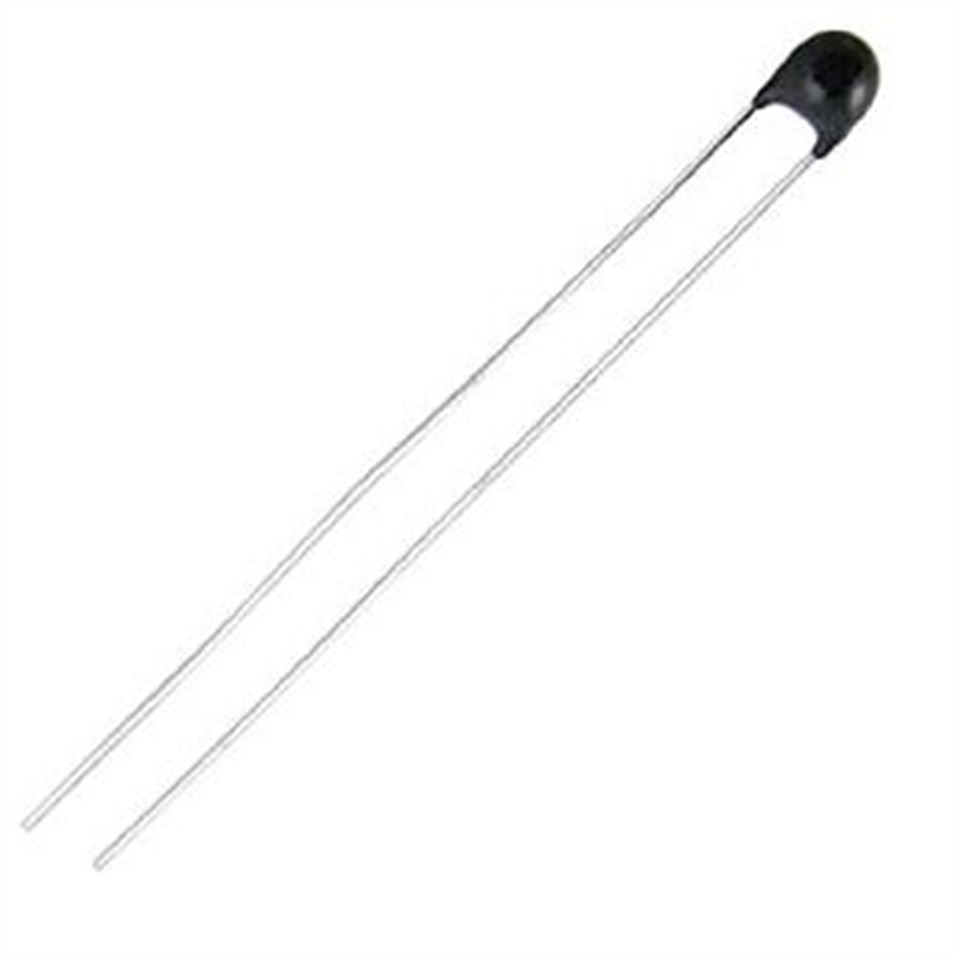

**Image source:** [https://www.ecembilgisayar.com/10k-ntc-termistor-3950k-hassas-sicaklik-sensoru-pmu210](https://www.ecembilgisayar.com/10k-ntc-termistor-3950k-hassas-sicaklik-sensoru-pmu210)

**What is it?**
A thermistor is a resistor whose resistance changes with temperature.

**How does it work?**
A common NTC thermistor decreases in resistance as temperature rises. A voltage divider allows the controller to measure the change.

**Example in a project**
Build a temperature-monitoring circuit or heat-warning indicator.

<small>Image match: Epoxy-bead NTC thermistor; exact resistance value in the kit may differ. License: Not verified; check source page before redistribution</small>

---

## 34. NPN Transistor (PN2222)

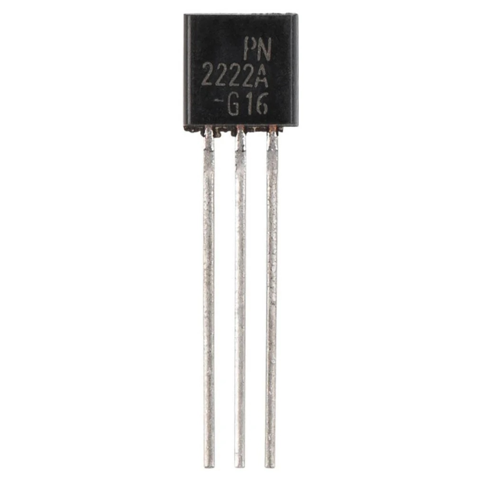

**Image source:** [https://linhkienhatech.com/products/linh-kien-transistor-pn2222a-to-92](https://linhkienhatech.com/products/linh-kien-transistor-pn2222a-to-92)

**What is it?**
The PN2222 is a general-purpose NPN transistor that can act as an electronic switch or amplifier.

**How does it work?**
A small base current controls a larger collector-to-emitter current, within the transistor's ratings. Check the pin arrangement for the exact part.

**Example in a project**
Use it to switch a small buzzer or motor from a controller output, with suitable protection for inductive loads.

<small>Image match: PN2222A NPN transistor in TO-92 package. License: Not verified; check source page before redistribution</small>

---

## 35. Diode 1N4007 Rectifier

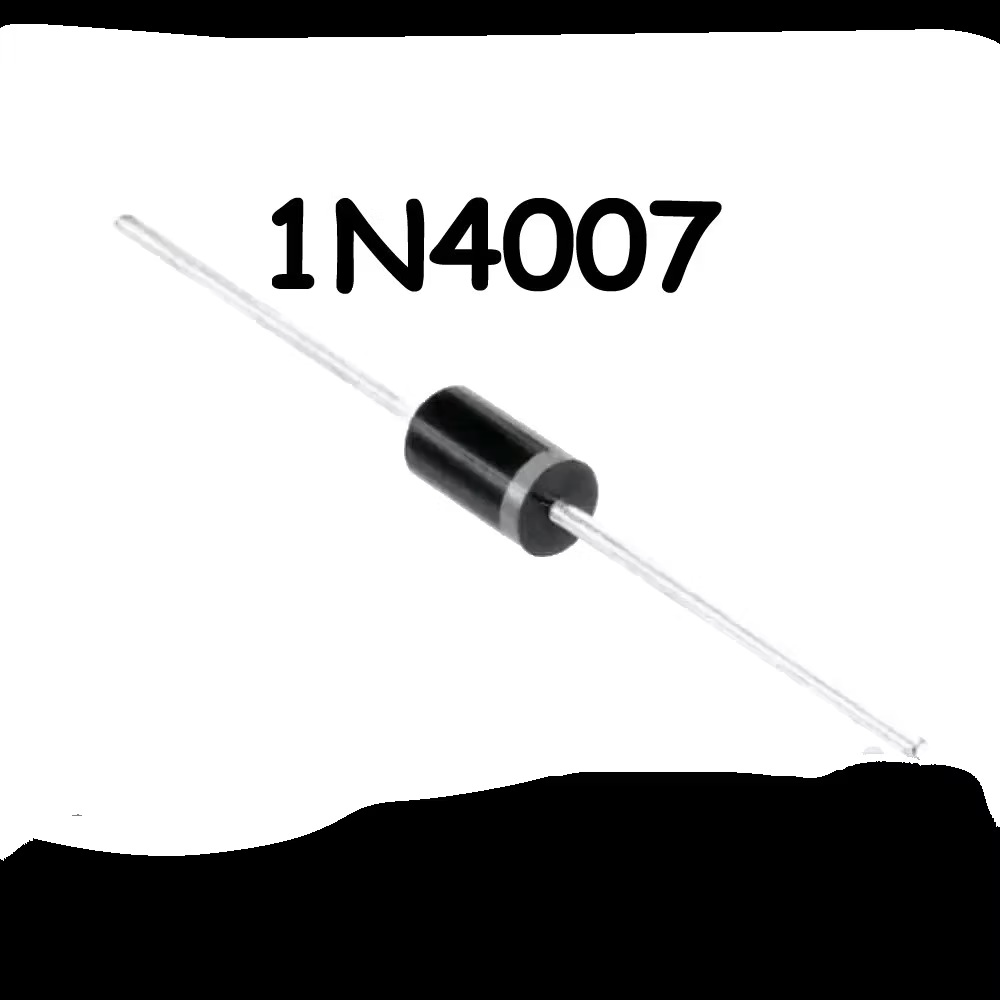

**Image source:** [https://www.grupocecaph.mx/product-page/1n4007-diodo-rectificador-1000v-1a](https://www.grupocecaph.mx/product-page/1n4007-diodo-rectificador-1000v-1a)

**What is it?**
The 1N4007 is a general-purpose rectifier diode.

**How does it work?**
It allows current to flow mainly in one direction and blocks it in the opposite direction, within its ratings. The band marks the cathode.

**Example in a project**
Use it for reverse-polarity protection or as a flyback diode across a suitable relay coil.

<small>Image match: 1N4007 axial rectifier diode; cathode band visible. License: Not verified; check source page before redistribution</small>

---

## 36. Red LED

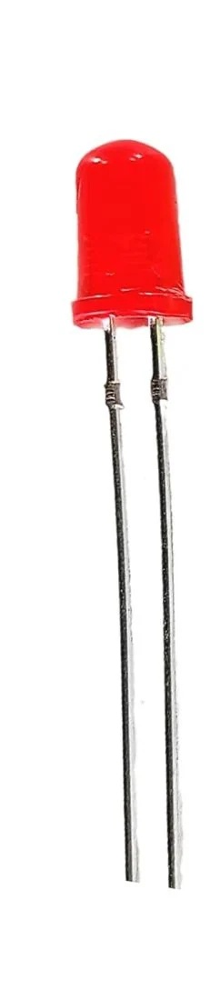

**Image source:** [https://paperquirks.in/products/5mm-led-light-assorted-kit-green-yellow-red-white-blue-50-pcs](https://paperquirks.in/products/5mm-led-light-assorted-kit-green-yellow-red-white-blue-50-pcs)

**What is it?**
A red LED is a light-emitting diode that produces red light when current flows in the forward direction.

**How does it work?**
It has polarity: the anode connects toward the positive side and the cathode toward ground. A current-limiting resistor is required.

**Example in a project**
Use it as a power indicator or warning light.

<small>Image match: Red LED cropped from a five-color assortment image. Crop is approximate. License: Not verified; check source page before redistribution</small>

---

## 37. Yellow LED

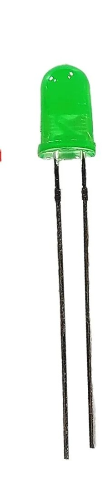

**Image source:** [https://paperquirks.in/products/5mm-led-light-assorted-kit-green-yellow-red-white-blue-50-pcs](https://paperquirks.in/products/5mm-led-light-assorted-kit-green-yellow-red-white-blue-50-pcs)

**What is it?**
A yellow LED emits yellow light when forward current flows through it.

**How does it work?**
Connect it with the correct polarity and a suitable current-limiting resistor to protect the LED.

**Example in a project**
Use it to indicate a waiting state or caution condition.

<small>Image match: Yellow LED cropped from a five-color assortment image. Crop is approximate. License: Not verified; check source page before redistribution</small>

---

## 38. Green LED

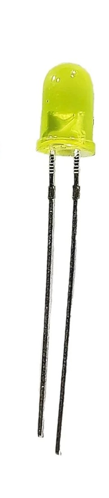

**Image source:** [https://paperquirks.in/products/5mm-led-light-assorted-kit-green-yellow-red-white-blue-50-pcs](https://paperquirks.in/products/5mm-led-light-assorted-kit-green-yellow-red-white-blue-50-pcs)

**What is it?**
A green LED emits green light when forward current flows through it.

**How does it work?**
The controller can switch it using a digital output, with a suitable series resistor and correct polarity.

**Example in a project**
Use it to indicate that a process is complete or a system is ready.

<small>Image match: Green LED cropped from a five-color assortment image. Crop is approximate. License: Not verified; check source page before redistribution</small>

---

## 39. Blue LED

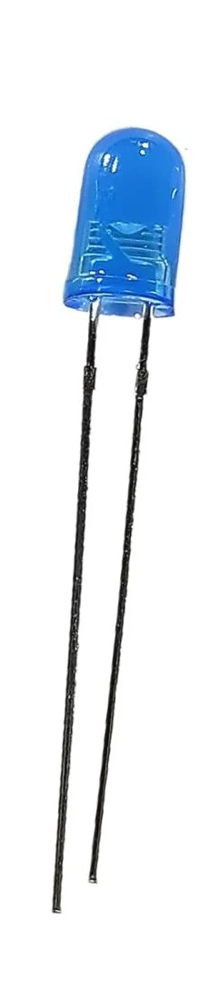

**Image source:** [https://paperquirks.in/products/5mm-led-light-assorted-kit-green-yellow-red-white-blue-50-pcs](https://paperquirks.in/products/5mm-led-light-assorted-kit-green-yellow-red-white-blue-50-pcs)

**What is it?**
A blue LED emits blue light when forward current flows through it.

**How does it work?**
It must be connected with correct polarity and a current-limiting resistor. Check the LED's forward-voltage requirements.

**Example in a project**
Use it as a status indicator in a prototype.

<small>Image match: Blue LED cropped from a five-color assortment image. Crop is approximate. License: Not verified; check source page before redistribution</small>

---

## 40. White LED

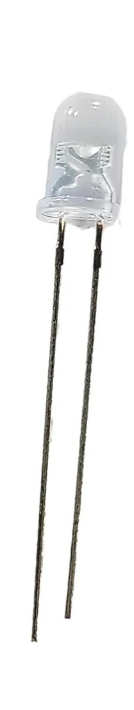

**Image source:** [https://paperquirks.in/products/5mm-led-light-assorted-kit-green-yellow-red-white-blue-50-pcs](https://paperquirks.in/products/5mm-led-light-assorted-kit-green-yellow-red-white-blue-50-pcs)

**What is it?**
A white LED produces white light and is commonly used for illumination or status indication.

**How does it work?**
It requires a suitable current-limiting arrangement and correct polarity. Do not connect it directly to a controller pin without current limiting.

**Example in a project**
Use it as a small indicator or light source in a model.

<small>Image match: White LED cropped from a five-color assortment image. Crop is approximate. License: Not verified; check source page before redistribution</small>

---

## 41. RGB LED

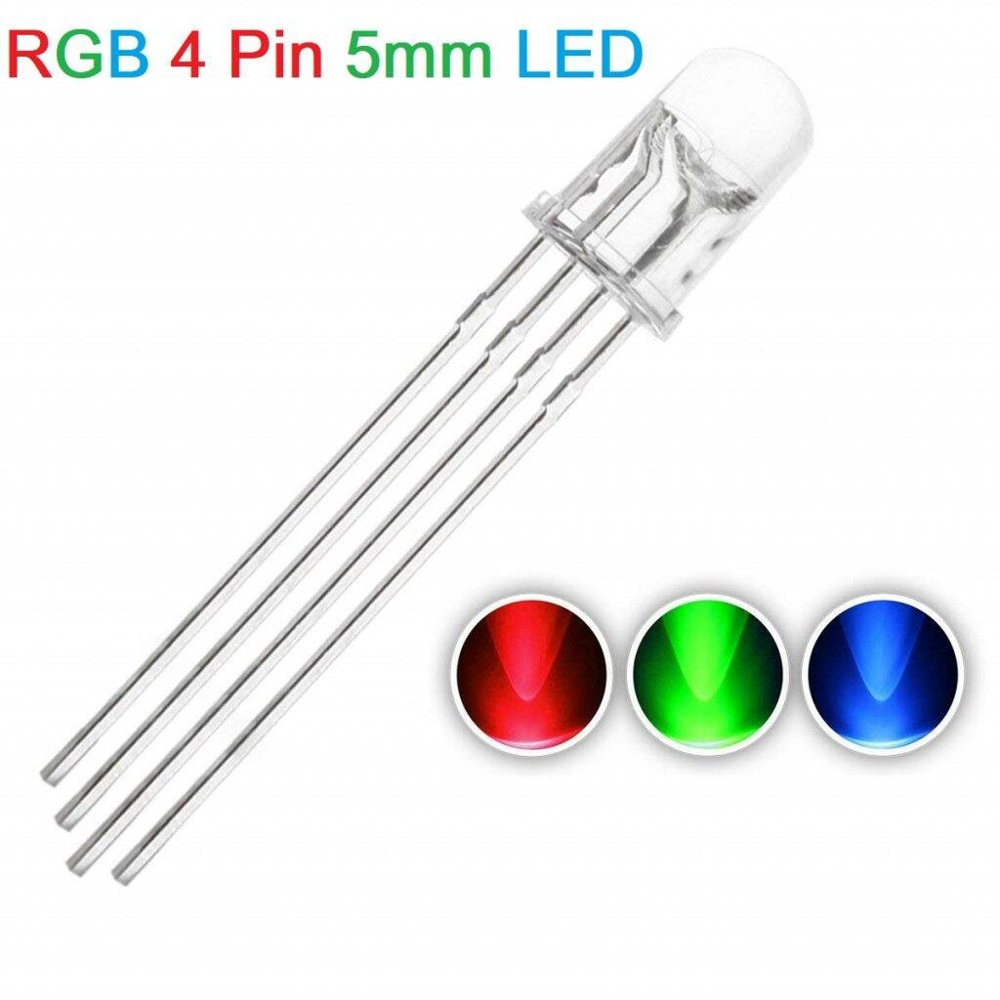

**Image source:** [https://www.daraz.com.bd/products/5pcs-4-pin-rgb-transparent-5mm-water-clear-rgb-led-5mm-4pin-transparent-round-5mm-led-light-emitting-diode-water-clear-rgb-leds-blinking-light-bulbs-for-electronics-project-i145614824.html](https://www.daraz.com.bd/products/5pcs-4-pin-rgb-transparent-5mm-water-clear-rgb-led-5mm-4pin-transparent-round-5mm-led-light-emitting-diode-water-clear-rgb-leds-blinking-light-bulbs-for-electronics-project-i145614824.html)

**What is it?**
An RGB LED combines red, green, and blue LED elements in one package.

**How does it work?**
By adjusting the brightness of each color channel, the controller can create many colors. Identify whether the LED is common-anode or common-cathode before wiring.

**Example in a project**
Show different system states using different colors.

<small>Image match: Clear 5mm four-lead RGB LED. Common-anode/cathode type must be checked on the actual part. License: Not verified; marketplace product image; check seller rights</small>

---

## 42. Resistor

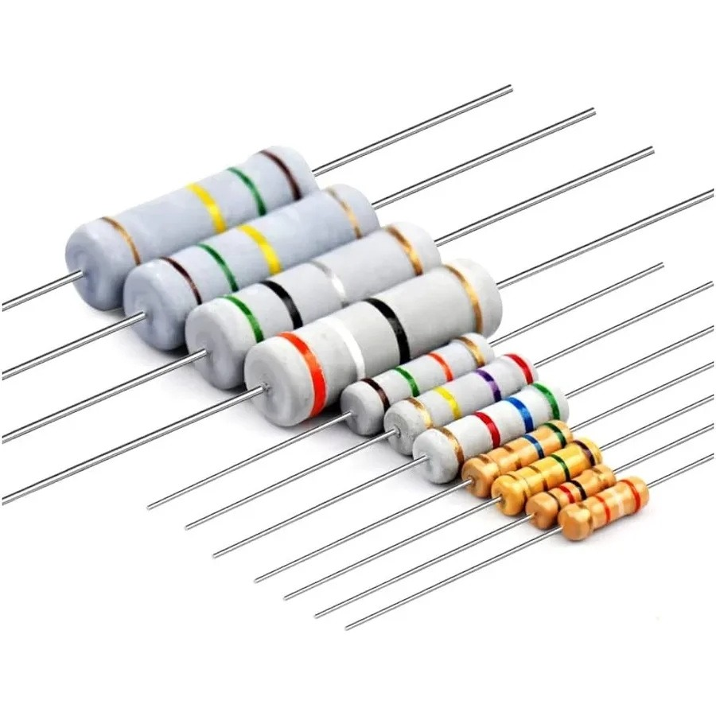

**Image source:** [https://www.allelcoelec.com/blog/Overview-of-Carbon-Film-Resistors.html](https://www.allelcoelec.com/blog/Overview-of-Carbon-Film-Resistors.html)

**What is it?**
A resistor limits current and creates voltage drops in an electrical circuit.

**How does it work?**
Its resistance is measured in ohms. The color bands or printed code indicate its value and tolerance.

**Example in a project**
Place a suitable resistor in series with an LED to limit current.

<small>Image match: Axial carbon-film resistors with color bands; image shows an assortment rather than a specific ohmic value. License: Not verified; check source page before redistribution</small>

---
