## Arduino UNO R3 Controller Board

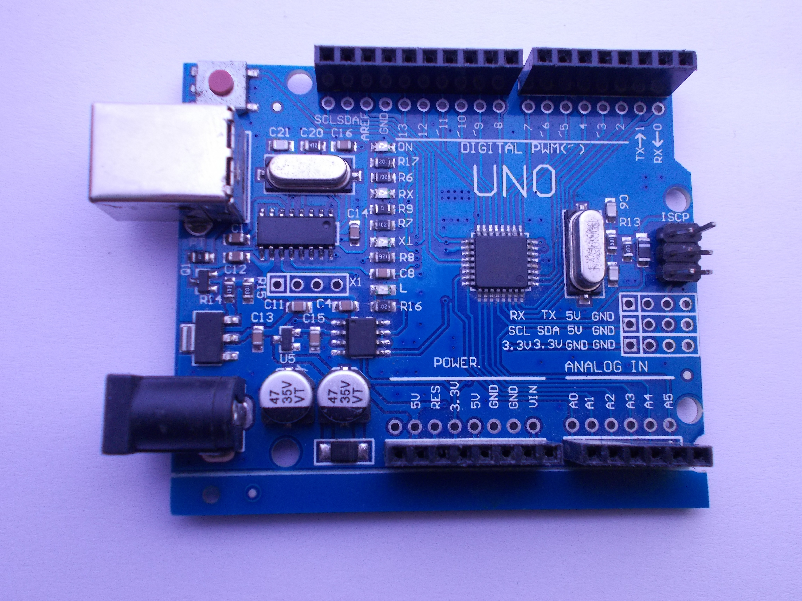

The board runs your program and controls the connected components.

## USB-A to USB-B Cable

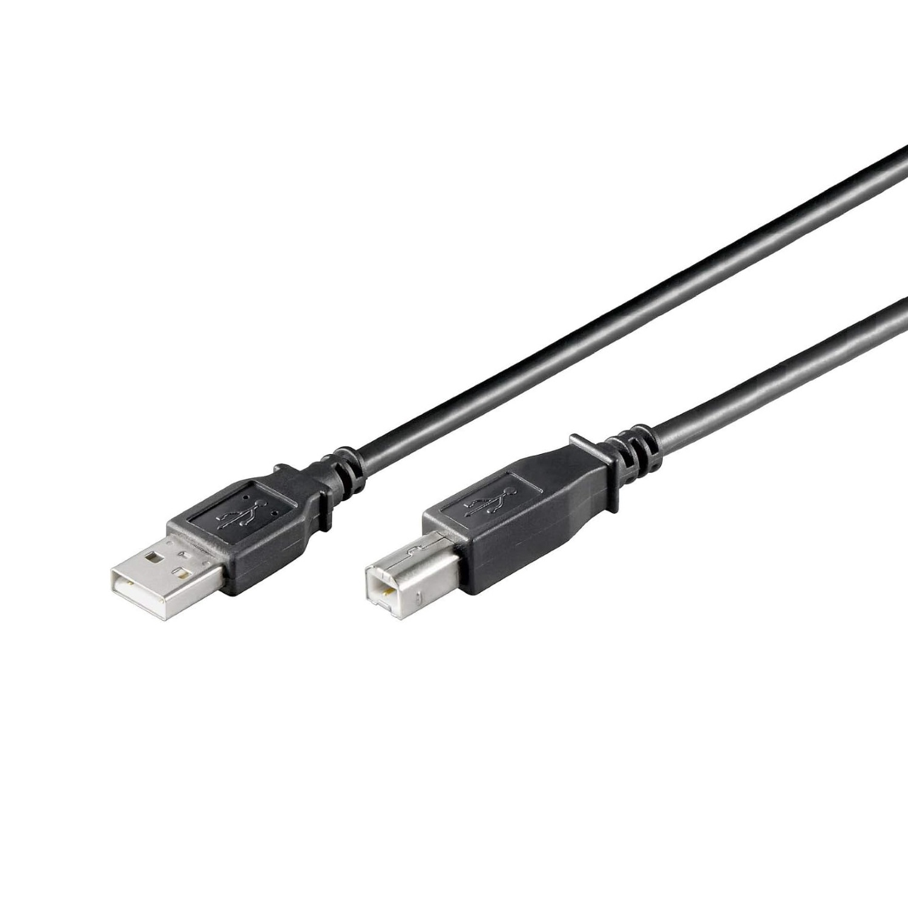

Connects the board to a computer for power and program uploads.

## 830-Point Breadboard

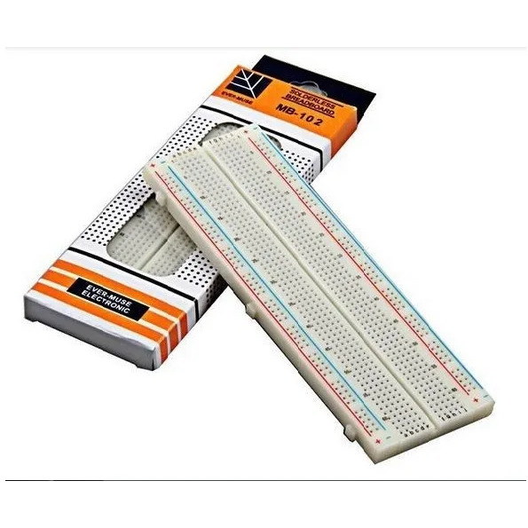

Lets you build and change circuits without soldering.

## Infrared Remote

Sends button commands to a compatible infrared receiver.

## 65 Jumper Wires

Connect components and board pins.

## 28BYJ-48 Stepper Motor

Turns in small, controlled steps.

## SG90 Servo Motor

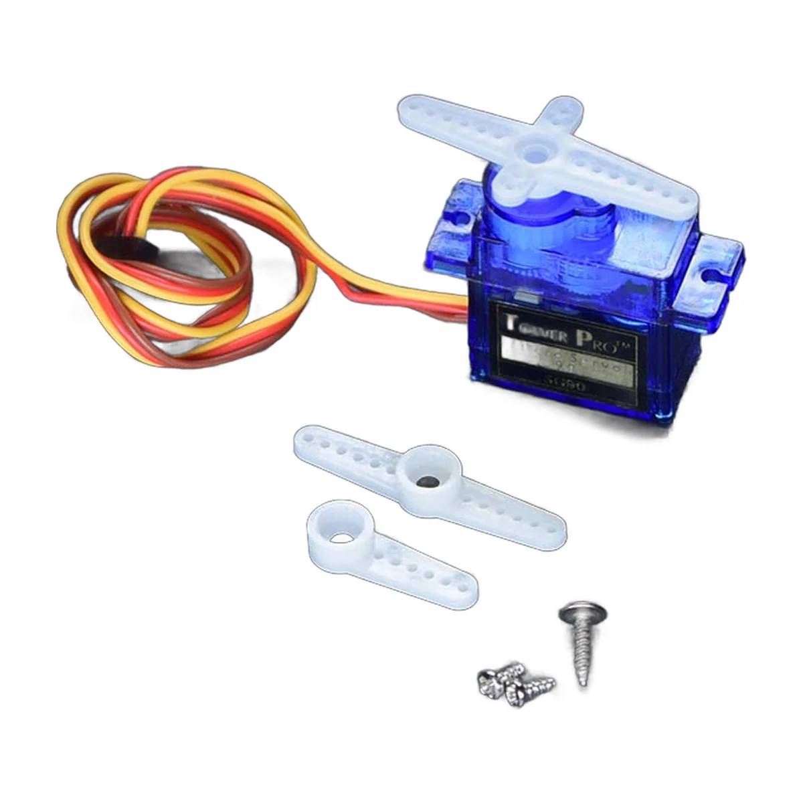

Moves its arm to a chosen angle.

## 1602 I2C LCD

Displays up to 16 characters on each of two lines.

## ULN2003 Stepper Motor Driver

Helps the board control the 28BYJ-48 stepper motor.

## MB102 Breadboard Power Supply

Provides power to the breadboard's circuit rails.

## KY-023 Joystick Module

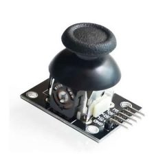

Senses left-right and up-down movement, plus a press.

## 4×4 Membrane Keypad

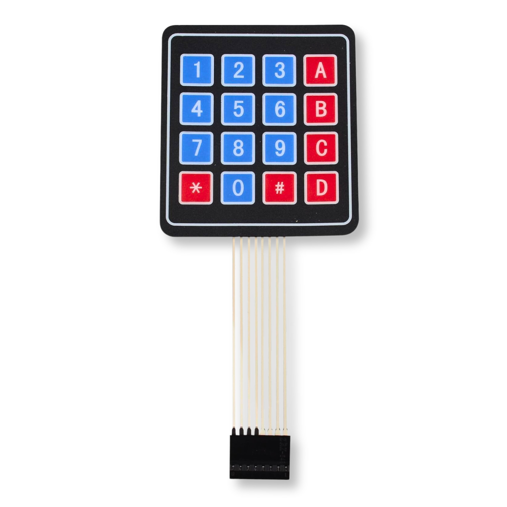

A flat keypad with 16 pressable buttons.

## Water-Level Sensor Module

Detects water using its exposed sensing tracks.

## KY-038 Sound Sensor Module

Uses a microphone to detect sound.

## Fan Blade

Moves air when attached to a spinning motor.

## Single-Digit 7-Segment Display

Shows one number using seven light-up segments.

## Four-Digit 7-Segment Display

Shows up to four numbers using light-up segments.

## HC-SR04 Ultrasonic Sensor

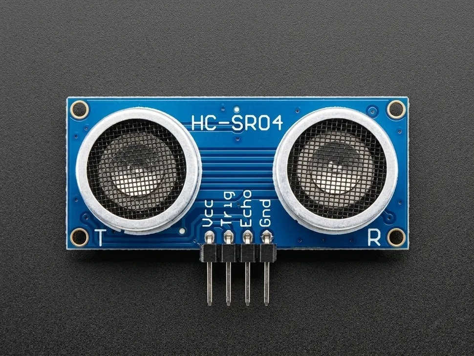

Measures distance using sound waves.

## DHT11 Temperature and Humidity Sensor

Measures the surrounding temperature and humidity.

## 10 kΩ Potentiometer

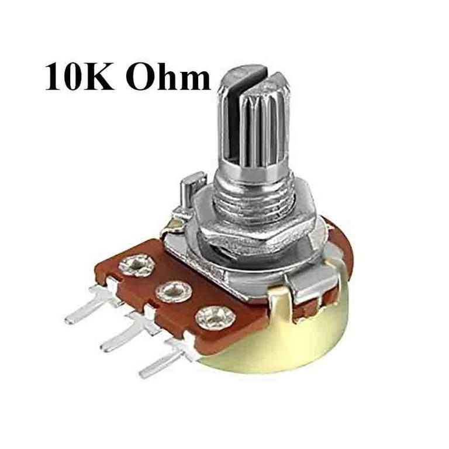

A knob that adjusts electrical resistance.

## VS1838B Infrared Receiver

Receives infrared signals, such as commands from a remote.

## 3–6 V DC Motor

Spins continuously when powered.

## 5 V Relay Module

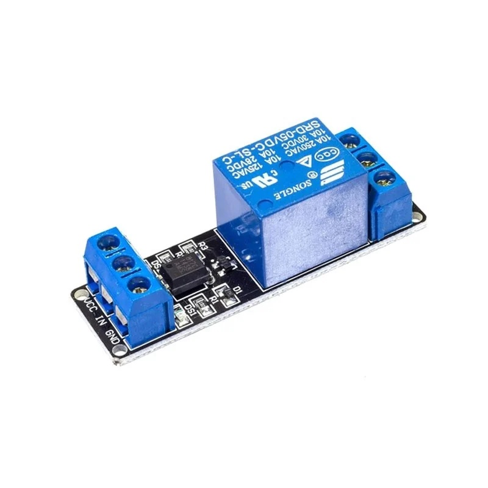

An electrically controlled switch for turning a circuit on or off.

## Female-to-Male Dupont Wires

Connect a female socket to a male pin.

## 9 V Battery-to-DC Connector

Connects a 9 V battery to a compatible DC power input.

## SW-520D Tilt Switch

Detects when its angle or position changes.

## L293D Motor Driver

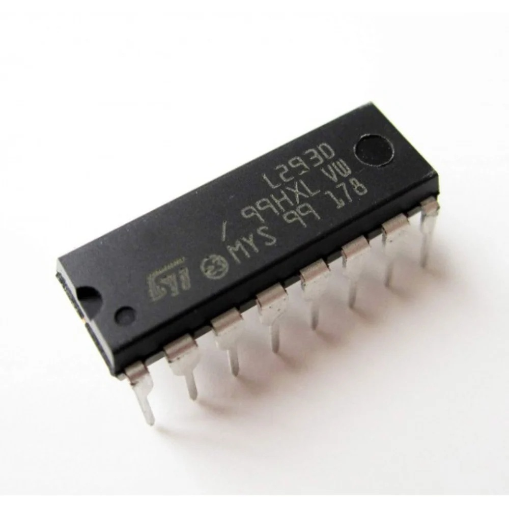

Controls the direction and speed of small motors.

## 74HC595 Shift Register

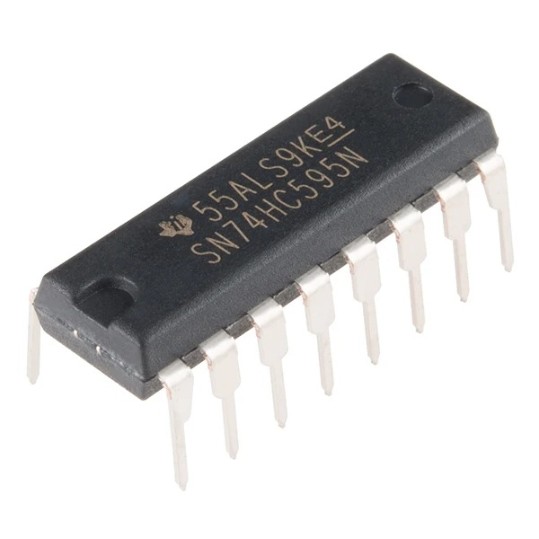

Lets the board control many outputs using fewer pins.

## Active Buzzer

Makes a tone when powered correctly.

## Passive Buzzer

Makes a tone when sent a changing electrical signal.

## Small Push-Button

Makes an electrical connection while pressed.

## Photoresistor (LDR)

Its resistance changes with the amount of light it receives.

## NTC Thermistor

Its resistance changes as its temperature changes.

## PN2222A NPN Transistor

Acts as an electronic switch or a small-signal amplifier.

## 1N4007 Diode

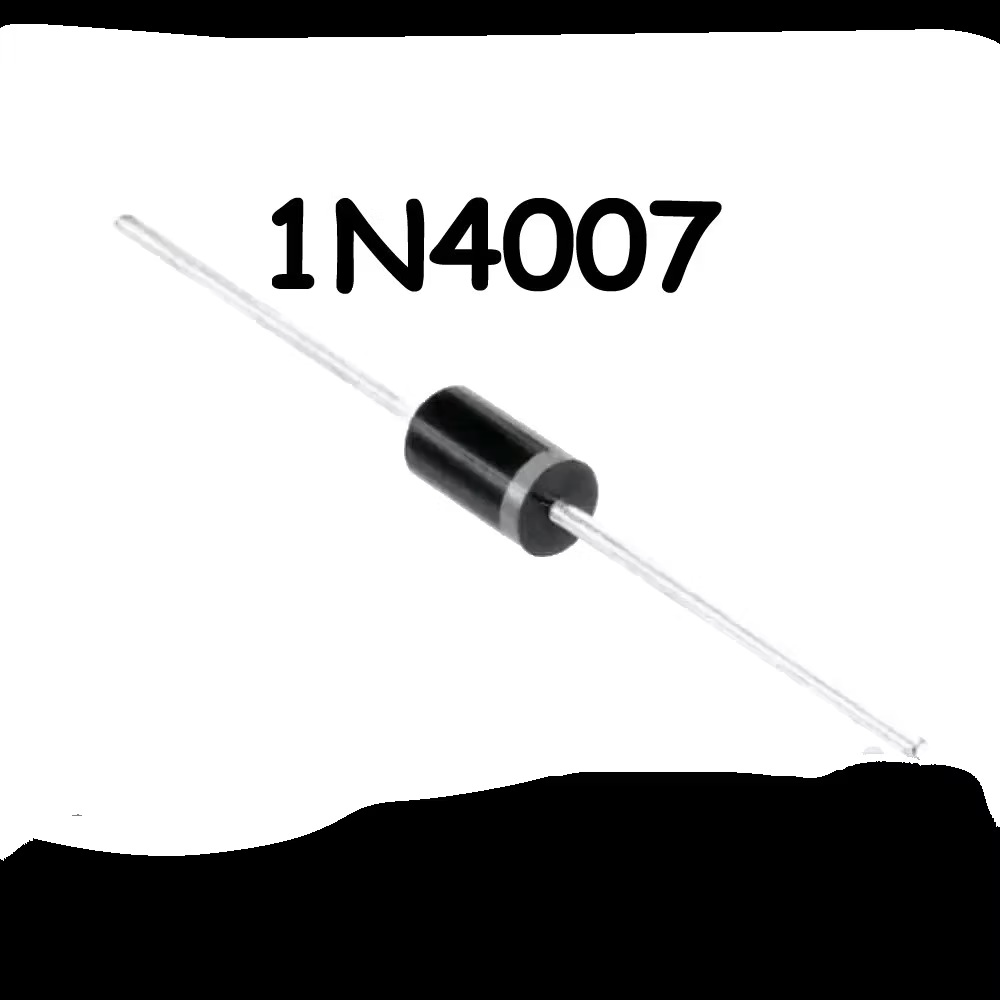

Allows current to flow mainly in one direction.

## Red 5 mm LED

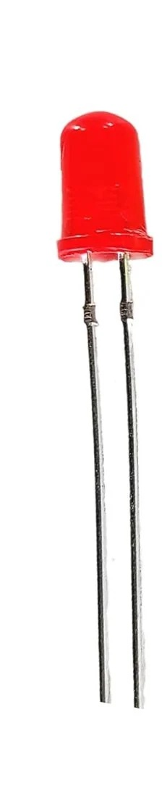

Lights up red when current flows through it.

## Yellow 5 mm LED

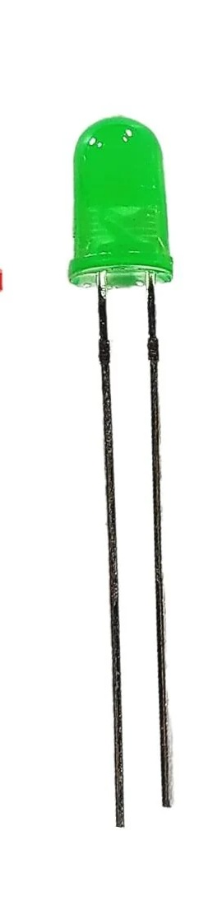

Lights up yellow when current flows through it.

## Green 5 mm LED

Lights up green when current flows through it.

## Blue 5 mm LED

Lights up blue when current flows through it.

## White 5 mm LED

Lights up white when current flows through it.

## 5 mm RGB LED

Combines red, green, and blue light in one LED.

## Resistor

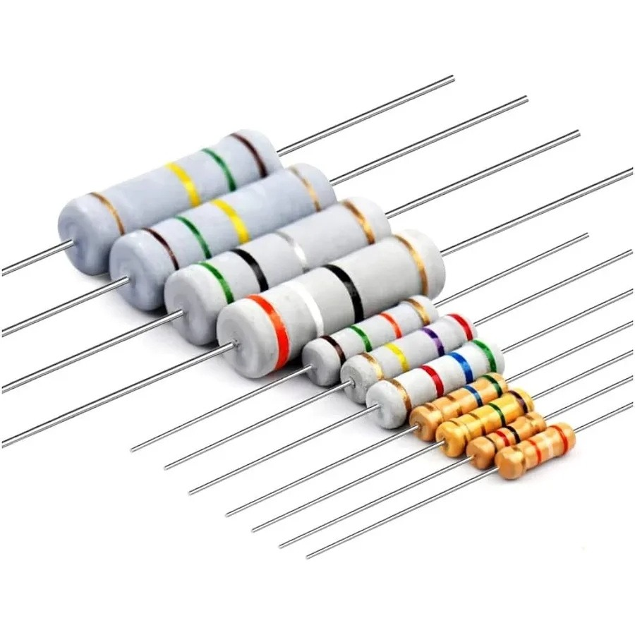

Limits electrical current in a circuit.
