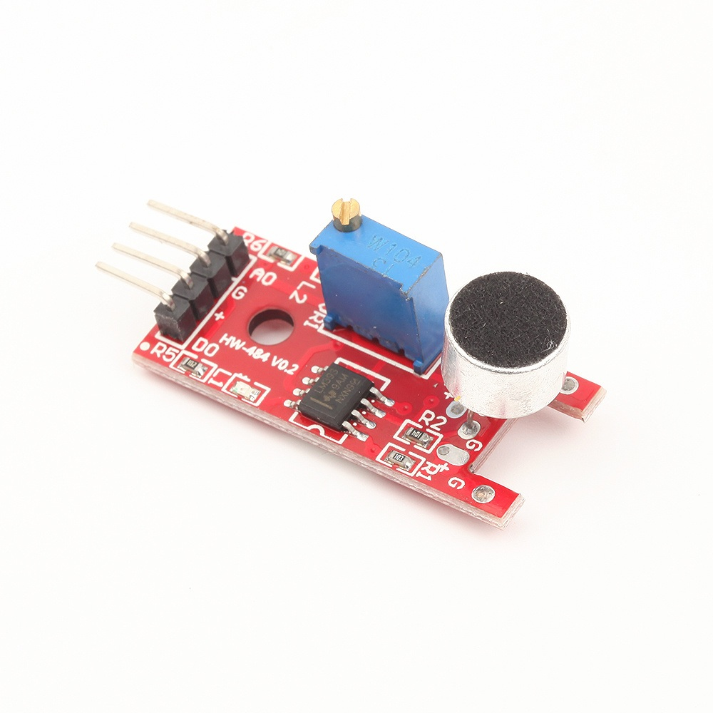
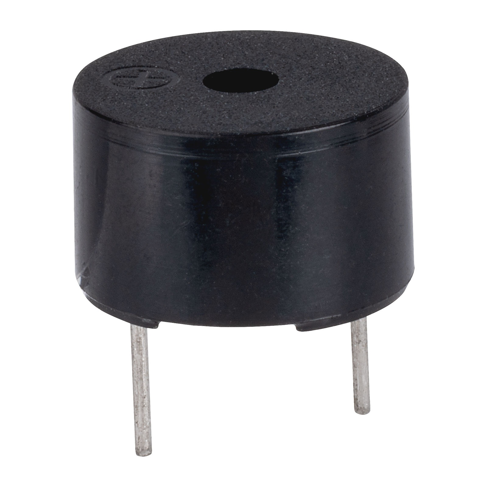
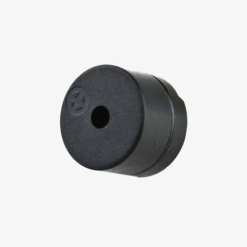
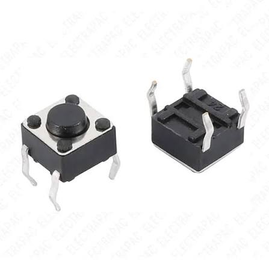
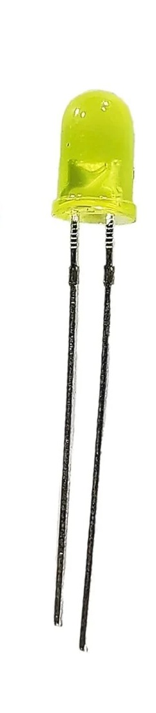
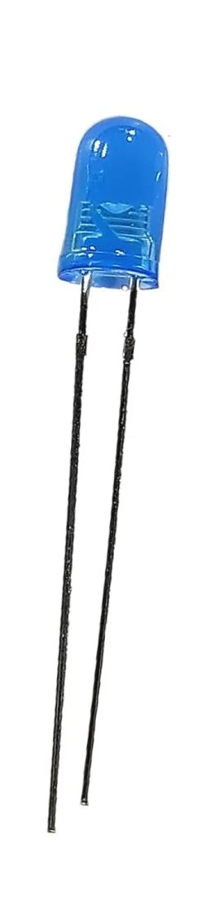
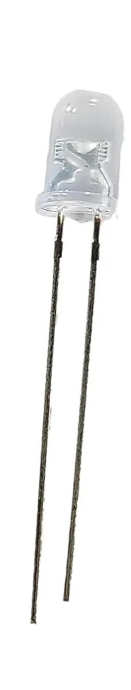
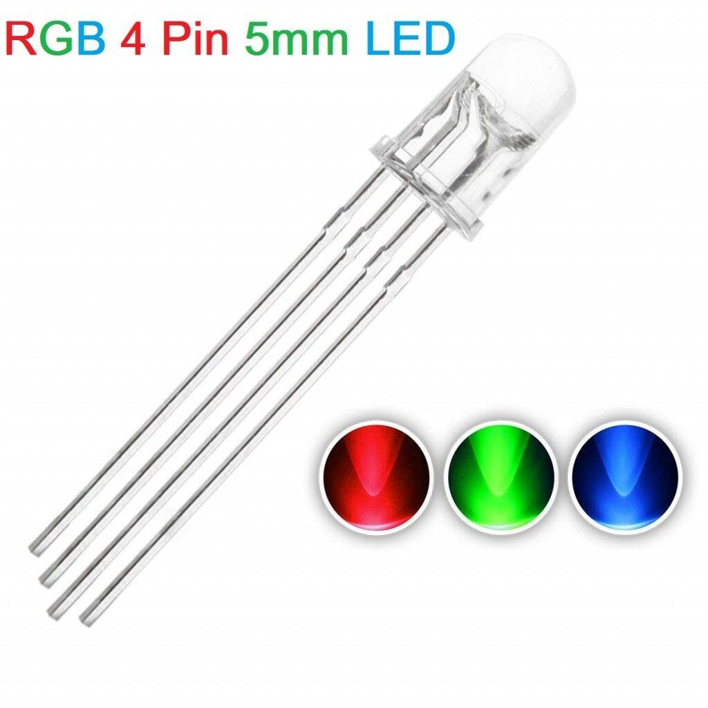

## Arduino UNO R3 Controller Board

**What it is:** The controller board runs the project program and sends signals to connected parts.

**Used for:** Running the project code and controlling connected parts.

**Example:** Use it to read a water sensor and switch on a pump.

## USB-A to USB-B Cable

**What it is:** The USB cable connects the controller board to a computer or compatible power source.

**Used for:** Powering the board and sending sketches from a computer.

**Example:** Connect it when uploading a sketch or checking serial output.

## 830-Point Breadboard

**What it is:** A breadboard lets you build temporary circuits without soldering.

**Used for:** Building temporary circuits without soldering.

**Example:** Build and test an LED circuit with a resistor.

## Infrared Remote

**What it is:** The remote is a handheld infrared controller with buttons.

**Used for:** Controlling a project from a distance.

**Example:** Press a button to switch an LED on or off.

## 65 Jumper Wires

**What it is:** Jumper wires connect components and board pins.

**Used for:** Connecting parts to the board and breadboard.

**Example:** Connect a sensor’s power, ground, and signal pins.

## 28BYJ-48 Stepper Motor

**What it is:** A stepper motor rotates in small, controlled steps.

**Used for:** Turning a part in small, precise steps.

**Example:** Move a small model gate in controlled steps.

## SG90 Servo Motor

**What it is:** A servo motor moves its output shaft to a chosen angle.

**Used for:** Moving an arm or part to a chosen angle.

**Example:** Open and close a small model barrier.

## 1602 I2C LCD

**What it is:** The 1602 I2C LCD is a character display that can show up to 16 characters on each of two lines.

**Used for:** Showing messages and readings.

**Example:** Show a sensor reading or welcome message.

## ULN2003 Stepper Motor Driver

**What it is:** The ULN2003 board helps control a small unipolar stepper motor.

**Used for:** Driving a compatible stepper motor.

**Example:** Control the 28BYJ-48 stepper motor.

## MB102 Breadboard Power Supply

**What it is:** The power supply module provides regulated power to breadboard rails.

**Used for:** Providing power to breadboard circuits.

**Example:** Power a low-voltage sensor circuit on a breadboard.

## KY-023 Joystick Module

**What it is:** A joystick module provides two-axis movement input and often includes a push-button switch.

**Used for:** Giving a project two-axis movement input.

**Example:** Use the stick to steer a servo or move through a menu.

## 4×4 Membrane Keypad

**What it is:** A membrane switch module is a flat keypad made of several pressable buttons.

**Used for:** Entering numbers or commands.

**Example:** Enter a PIN for a simple electronic lock.

## Water-Level Sensor Module

**What it is:** This sensor detects water at its exposed sensing tracks.

**Used for:** Detecting water level.

**Example:** Light an LED when water reaches a set level.

## KY-038 Sound Sensor Module

**What it is:** The sound sensor detects sound using a microphone.

**Used for:** Detecting sound.

**Example:** Turn on an LED when the sensor detects a clap.

## Fan Blade

**What it is:** A fan blade moves air when it rotates.

**Used for:** Moving air when attached to a motor.

**Example:** Attach it to a motor to make a small fan.

## Single-Digit 7-Segment Display

**What it is:** A one-digit 7-segment display shows numbers using seven individual LED segments.

**Used for:** Displaying one digit.

**Example:** Display a counter from 0 to 9.

## Four-Digit 7-Segment Display

**What it is:** A four-digit 7-segment display shows four numeric digits in one module.

**Used for:** Displaying several digits.

**Example:** Show a timer or score.

## HC-SR04 Ultrasonic Sensor

**What it is:** An ultrasonic sensor measures distance using high-frequency sound waves.

**Used for:** Measuring distance to an object.

**Example:** Light an indicator when an object gets close.

## DHT11 Temperature and Humidity Sensor

**What it is:** The DHT11 measures surrounding temperature and relative humidity.

**Used for:** Measuring temperature and humidity.

**Example:** Show room readings on an LCD.

## 10 kΩ Potentiometer

**What it is:** A 10K potentiometer is an adjustable resistor with three terminals.

**Used for:** Adjusting an electrical setting.

**Example:** Adjust LED brightness or set a threshold.

## VS1838B Infrared Receiver

**What it is:** An infrared receiver detects coded infrared light signals, such as those sent by a compatible remote.

**Used for:** Receiving commands from an infrared remote.

**Example:** Change a project mode with remote-control buttons.

## 3–6 V DC Motor

**What it is:** A small 3–6 V DC motor converts electrical power into spinning motion.

**Used for:** Creating continuous spinning motion.

**Example:** Spin a small wheel or fan.

## 5 V Relay Module

**What it is:** A relay is an electrically controlled switch; this module uses a 5 V coil.

**Used for:** Switching another circuit electronically.

**Example:** Switch a suitable low-voltage lamp.

## Female-to-Male Dupont Wires

**What it is:** Female-to-male Dupont wires connect a female socket at one end to a male pin at the other.

**Used for:** Making removable wire connections.

**Example:** Connect a module to a breadboard or board header.

## 9 V Battery-to-DC Connector

**What it is:** This connector links a 9 V battery to a compatible DC power input.

**Used for:** Connecting a 9 V battery to a compatible power input.

**Example:** Power a compatible project designed for a 9 V input.

## SW-520D Tilt Switch

**What it is:** A tilt switch detects a change in orientation or inclination.

**Used for:** Detecting tilt or movement.

**Example:** Trigger an alert when a model is tilted.

## L293D Motor Driver

**What it is:** The L293D is a dual H-bridge motor driver chip.

**Used for:** Controlling motor direction.

**Example:** Make a small robot move forward and backward.

## 74HC595 Shift Register

**What it is:** The 74HC595 is an 8-bit serial-in, parallel-out shift register.

**Used for:** Adding more digital outputs with fewer board pins.

**Example:** Control several LEDs using only a few board pins.

## Active Buzzer

**What it is:** An active buzzer makes a tone when powered correctly.

**Used for:** Making a simple sound alert.

**Example:** Sound an alert when a sensor detects a condition.

## Passive Buzzer

**What it is:** A passive buzzer needs a changing signal to make a tone.

**Used for:** Playing tones controlled by the board.

**Example:** Play different beeps for menu choices.

## Small Push-Button

**What it is:** A small push-button is active only while pressed.

**Used for:** Providing a press-to-activate input.

**Example:** Start a timer or select a menu option.

## Photoresistor (LDR)

**What it is:** A photoresistor changes its resistance depending on the amount of light falling on it.

**Used for:** Detecting changes in light.

**Example:** Turn on a light automatically when it gets dark.

## NTC Thermistor

**What it is:** A thermistor is a resistor whose resistance changes with temperature.

**Used for:** Detecting changes in temperature.

**Example:** Make a temperature warning indicator.

## PN2222A NPN Transistor

**What it is:** The PN2222 is an NPN transistor that can act as a switch or amplifier.

**Used for:** Switching a load using a small control signal.

**Example:** Switch a small buzzer or motor from a board output.

## 1N4007 Diode

**What it is:** The 1N4007 is a general-purpose rectifier diode.

**Used for:** Allowing current to flow mainly in one direction.

**Example:** Help protect a circuit from reverse current.

## Red 5 mm LED

**What it is:** A red LED produces red light when current flows through it.

**Used for:** Giving a project a red light indicator.

**Example:** Show a warning or power status.

## Yellow 5 mm LED

**What it is:** A yellow LED produces yellow light when current flows through it.

**Used for:** Giving a project a yellow light indicator.

**Example:** Show a caution or waiting status.

## Green 5 mm LED

**What it is:** A green LED produces green light when current flows through it.

**Used for:** Giving a project a green light indicator.

**Example:** Show that a process is ready or complete.

## Blue 5 mm LED

**What it is:** A blue LED produces blue light when current flows through it.

**Used for:** Giving a project a blue light indicator.

**Example:** Show a status in blue.

## White 5 mm LED

**What it is:** A white LED produces white light.

**Used for:** Providing a small white light.

**Example:** Add a small light to a model.

## 5 mm RGB LED

**What it is:** An RGB LED combines red, green, and blue LEDs in one package.

**Used for:** Making several colors from one LED.

**Example:** Show different project states with different colors.

## Resistor

**What it is:** A resistor limits current and creates voltage drops in an electrical circuit.

**Used for:** Limiting current in a circuit.

**Example:** Place it in series with an LED to limit current.
